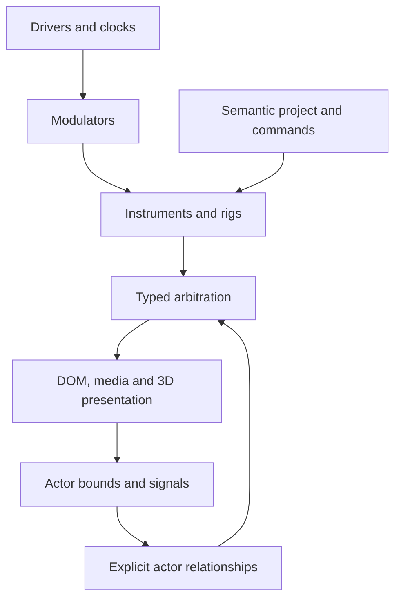

# iGlass Pose Studio — authoritative master build plan

**Plan ID:** `PS-MASTER`  
**Operative edition:** **14 October 2026 — visual instruments, reusable choreography and human-owned UI/UX**  
**Canonical source:** `playwithlifenow-eng/IphoneAnimation`, branch `studio/visual-instruments-poc`, path `studio/docs/master-plan.md`  
**Reviewed software:** Studio 0.4.0 at `96927871067e235a99bd415fa7ec02675b0ec967`  
**Source verification:** the live branch's `engine.ts` matches that reviewed snapshot at blob `c8ee2dcda6d5aed60debb68cac1001f88b2cfc22`; the preceding master-plan blob was `04d0228dcd9ad270355750286ab8abb779b2c5d3`.  
**Status:** the PoC is an engineering testbed; Matthew has not accepted its UI or an evolutionary advance. This edition updates the plan, not the software's capabilities or test results.

## Read first — continuity contract for Astra, GPT and Gemini

**Purpose:** creativity develops faster than Matthew can describe it in words. Studio combines Framer/Webflow-like spatial fluidity with editable pre-built capabilities, full primitive access and genuine cross-actor emergence.

**Preferred interaction:** ON/OFF activates a meaningful behaviour; an on-canvas gesture continuously shapes it. A single action can coordinate multiple states and properties. Precision, primitives and the full meaningful parameter range remain available.

**Authority:** Matthew owns workflow and UI/UX decisions. Gemini actively helps discover lower-friction workflows. Astra engineers reusable mechanisms and adapts them to Matthew's designs. AI may independently identify and research missing general capabilities; Matthew need not supply algorithms or enumerate every technical requirement.

**Current next direction:** a rapidly editable UI Lab plus source-grounded research of missing general mechanisms, followed by thin real-engine integration of selected workflows. Preserve working capabilities and the accepted Hero. No blanket rebuild, compulsory new research swarm or automatic expansion of every future subsystem.

**Evidence:** reusable capability, adjustable instrument, compound rig, preset, visual proxy and verified production integration are different things. Passing tests does not establish creative usefulness. Source-review findings do not become rerun test results.

At the start of a future work session:

1. Read this canonical edition, especially §§1–4, 18–24. Confirm the branch and reviewed software identity; do not default to `main` or an older ZIP.
2. Record the requested task, relevant approved UI/reference, current implementation evidence and remaining uncertainty. Do not ask Matthew to restate settled purpose or preferences.
3. Check the current capability ledger/source for affected mechanisms. Treat unverified improvements as planned.
4. Distinguish engineering decisions from UI proposals. Reuse confirmed work; show editable choices when the interaction design remains open.
5. Before finishing, preserve a concise continuation record: exact source revision, changes/tests, decisions, blockers and next concrete work. Update this plan when a governing decision changes instead of appending contradictory directives.

**Precedence:** this edition supersedes the 28 September broad-V1-first directive, the 12 October Milestone 1-first directive and the 13 October PoC build-now directive. Earlier briefs and historical commits preserve evidence but do not reinstate dark chrome, Takes modals, preset-only tools or AI design authority. The Living Engineering Manual describes capability research; approved UI Lab designs describe presentation. This master plan governs ownership, priorities and status when older records conflict. Current explicit user instructions take precedence.

**Navigation:** [Purpose](#1-executive-direction) · [Ontology](#2-revised-ontology-and-complete-architecture) · [Engine contracts](#3-authoring-representation-instruments-and-runtime) · [Human workflows](#4-creative-instruments-and-the-creative-ceiling) · [Current capability audit](#18-operative-subsystem-commitment-matrix) · [Execution](#19-authoritative-execution-sequence) · [Acceptance](#23-integrated-v1-acceptance-and-later-expansion) · [Handoff](#24-operative-build-directive).

## 1. Executive direction

### 1.1 Purpose, creative ambition and balance

**Build a visual environment where creativity develops faster than Matthew can describe it in words.** He should discover layouts, choreography, relationships and visual experiences by seeing, manipulating and comparing them. AI translates the selected result into a supported implementation and verifies the actual output against that intent.

Studio should preserve the fluid cursor interaction, spatial canvas, parent/child frames, selection feedback and responsive editing Matthew values in Framer and Webflow, while enabling much greater emergence through reusable pre-built capabilities. “A hundred times more emergent” is the ambition, not a measured superiority claim. Superiority is judged on his actual iGlass design tasks.

**Compound capabilities and primitives are complementary.** Ready-made behaviours remove repeated setup; frames, text, shapes, transforms, paths, lower-level tracks and precise values remain available for construction and refinement. Neither an enormous primitive control panel nor a closed template library meets the objective.

The distinctive value is coordination: a phone's movement affects text, images, light or camera framing; scenes transition together; several actors participate in one editable event. Individual assets may be created elsewhere. The iPhone is one test fixture for general compatible-asset manipulation, not a privileged engine type.

### 1.2 Division of authority

| Role | Responsibility |
|---|---|
| Matthew | Describes the perceived result and desired authoring experience; designs/chooses UI, gestures, layout, disclosure and terminology; judges creative usefulness |
| Gemini | Active UI/UX research partner; maps reference workflows, proposes shorter compound interactions, generalizes video evidence and independently challenges engineering assumptions |
| Astra | Engineering developer/integrator; researches and implements reusable capabilities, adapts contracts to chosen UI, fixes objective defects and verifies persistence/runtime/delivery |
| GPT | Analysis, continuity, reviews and scoped design support under Matthew's model/workflow choices; no silent substitution for Astra in substantive production builds |

The interface is not subordinate to the current engine. A desired workflow may reveal a necessary state, command, input or capability extension. Explain real constraints and viable routes; do not silently redesign Matthew's interface to avoid engineering work.

AI can determine missing general capabilities independently. It must not wait for Matthew to specify a spring solver, path representation, coordinate transform or arbitration algorithm. His phenomenological descriptions guide priority and acceptance; they do not create the underlying mathematical possibilities.

### 1.3 What went wrong and what is corrected

| Earlier assumption / failure | Operative correction |
|---|---|
| A mathematically possible effect means the tool is complete | A usable instrument supplies defaults, activation, direct control, composition and reliable state handling |
| Document fields determine UI layout | Matthew's workflow determines presentation; the engine exposes an appropriate command/capability surface |
| More sliders solve numerical confusion | Outcome-first handles, Boolean activation, compound actions and progressive precision reduce intermediate work |
| Separate tabs/forms are acceptable for related tasks | Keep composition, alternatives and relevant controls visually connected; avoid forced working-memory reconstruction |
| A fast arrangement preset is a new creative capability | Test whether it removes actual work and exposes useful variation; a renamed scale change may add nothing |
| Each visual result needs its own implementation | Build reusable paths, state transitions, signals, links and rig contracts that support many results |
| Every instrument/state must compile to old tracks | Preserve existing tracks, but permit versioned instrument/state data with one coherent evaluation authority |
| All outputs can use an additive property bus | Use typed composition, priorities, stateful response and explicit ownership handoffs |
| AI already knew an insight because it can explain it later | Record known-before, observed, newly inferred and verified-after evidence separately |
| Passing checks prove creative success | Technical evidence, actual touchpad usability and Matthew's creative acceptance remain distinct |

These defects do not erase the useful command, persistence, rendering or experimental research. They do require replacing the operative assumptions and sequence rather than treating the existing plan as complete.

### 1.4 Baselines, chronology and evidence

| Stage | Meaning |
|---|---|
| 17 September research | 211-app interaction-mechanism commission; minimizing switching and tool hunting was already intended. Its list excluded major incumbents, so Framer/Webflow interaction benchmarking needs direct references. |
| `f29fd7c` / 0.3.0 | Integrated engineering alpha; numerical Inspector and fragmented workflows remained inadequate |
| `03eea25d814dbfc77ce0f6e09229b5668f99c71d` / 0.3.1 | Milestone 1 visual text/typography/opacity and one-click snapshots; dark shell and comparison bureaucracy persisted |
| `96927871067e235a99bd415fa7ec02675b0ec967` / 0.4.0 | Separate PoC with light spatial editor, instrument registry, state transitions, compound Beats, relationship graph and intent replay |
| 14 October hands-on feedback | Cleaner UI did not demonstrate low-friction creation; frozen controls, intrusive panels, selection/Frame gaps, misleading presets and legibility problems reported |
| This edition | Human-owned UI/UX, Boolean-first compound controls, primitive access and independently researched general engine gaps become operative |

The software receipts record 49 unit tests, 38 legacy browser checks, 18 PoC browser checks and seven visual demonstrations. Their source hash `9ec6ed54b028754321e35ea6e95c83fba95e47f493f3fcea11326026c3607b99` matches the supplied archive. This planning task did not rerun those tests. Linux/SwiftShader captures, with condensed delivery playback, do not measure Windows laptop responsiveness.

The accepted production Hero remains protected. Historical E0 references identify deployed commit `ef3850a8d74619c99ac79eb833eeb31e86ef8dad`, scene `7.5.51-mobile-headline-telemetry`, Framer DOM driver and separate Vercel scene. They are historical protection/identity evidence, not a claim of the current deployment state. Do not resurrect an old archive mismatch as a present Hero bug.

## 2. Revised ontology and complete architecture

### 2.1 What exists

| Entity | Meaning and authority |
|---|---|
| Asset | Versioned source media, geometry, component or content; distinct from its instances |
| Actor | Stable on-canvas participant: frame, text, media, model/part, camera or light |
| Context / world | Layout or 3D environment with explicit coordinates, lifecycle and interaction scope |
| Driver | Scroll, velocity, pointer/drag, time, event, viewport or actor output |
| Modulator | Mapping/response: easing, phase, delay, spring/damping, threshold, limits or blending |
| Capability | Reusable operation the engine actually supports, independent of a preset |
| Instrument | Playable interface over one or more capabilities, with activation and meaningful control |
| Relationship | Explicit coupling/constraint between actors or channels |
| Compound rig / Beat | Reusable coordination of actors, instruments, states and transitions over an authored span |
| Preset | A stored configuration or arrangement; useful starting point, not a new engine |
| Variant / snapshot | Independent creative alternative or retained history state; linked responsive views are different |
| Evidence / decision | Source, observed output, test, interpretation and human preference with scope and provenance |

An adjustable instrument occupies the middle between a mathematical primitive and a finished preset. A rig must preserve editable targets, endpoints, paths, timing and relationships; otherwise it is only a playback recipe.

### 2.2 Four tiers and complementary control dimensions

1. **Metronome / environment:** shared signals, dynamics, clocks and global environment policies.
2. **Actors:** objects and nested containers placed and selected on the canvas.
3. **Instruments:** reusable behaviours attached to compatible actor/stage/relationship targets.
4. **Compound Beats / rigs:** multi-actor behaviour and coordinated state transitions.

These classify responsibility; they do not require four panels, four databases or one rigid tree. Stage scope and cross-actor links connect the tiers. **Drivers → Modulators → Targets** describes complementary control dimensions, not a theorem that three orthogonal vectors explain every possible website.



Ordinary derived relationships evaluate in an acyclic order. Feedback requires a declared delay, stateful operator or solver, with reset, stability and checkpoint policy. A measured-output cycle must not become accidental frame-to-frame oscillation.

### 2.3 Single semantic authority, multiple practical implementations

The versioned project owns actors, content, instruments, states, blocks, clocks, paths, links, profiles and asset references. The evaluator derives effective outputs; rendering and export do not silently rewrite authored intent. Runtime checkpoints are explicit operator state, not a second composition document.

Visual proxies may communicate useful intent while the final renderer uses different mechanisms. Preserve their fidelity/status so plausible appearance is not mistaken for verified geometry, optics or science. Framer, Webflow and custom React/Three/GSAP are delivery routes; they do not dictate the authoring UI.

A composition may fill the viewport, become content on an embedded surface and appear as an object in another composition. Context Bridge / World Dive coordinates that perceptual continuity; it need not require one enormous WebGL world or one permanent canvas.

### 2.4 Protected references and conditional research

Keep working project, accepted creative state, integrated implementation and production release as separate versioned references. Normal gestures remain fluid; accepting an experiment is not a modal on every edit.

Create, observe, experiment and remember/promote remain useful responsibilities. The probe, evidence, island, knowledge, recombination and promotion chapters below preserve long-term research. They are not claims of shipped systems, prerequisites for basic authoring, or prescriptions for permanent UI panels.

## 3. Authoring representation, instruments and runtime

### 3.1 Durable authoring model

Store actors and hierarchy, content, assets, primitive properties, instrument instances, paths, scene states, action blocks/Beats, driver/modulator configuration, relationship links, responsive overrides, lifecycle/quality alternatives and retained history. Stable identity must survive rearrangement, duplication, transition and representation changes.

The current PoC's `VisualProject`, variants, `InstrumentInstance`, `SceneState`, `StoryBeat` and `ActorLink` are real starting structures. Existing property tracks remain supported. Do not require every operation to traverse an arbitrary stack of macros/patterns or delete the newer state/instrument model to satisfy an old track-only rule.

The requested path/block model needs separate translation and orientation channels, local/world/screen-space declarations, editable endpoints, curve/tangent information, duration/range, hold/reversal and responsive decisions. Multiple independent state sequences must be representable; each can target its own actor set and clock scope.

### 3.2 Universal instrument and component contracts

Gemini's VST analogy supplies a useful integration standard: common targeting, signals, command semantics, serialization, evaluation, lifecycle and delivery. It does not guarantee interoperability by naming a TypeScript interface. The current fixed evaluator switch is a bounded catalogue, not arbitrary plugin execution.

```yaml
instrument_definition:
  identity: stable_id_and_version
  kind: reusable_instrument_or_compound_rig_or_preset
  targets: actor_capabilities_parts_and_coordinate_spaces
  inputs_outputs: typed_units_ranges_defaults_and_port_identity
  drivers: supported_sources_events_and_clocks
  modulators: supported_response_and_state_contracts
  composition: channel_specific_arbitration_and_handoffs
  controls: approved_visual_handles_and_full_meaningful_range
  bypass: neutral_contribution_and_settings_retention
  lifecycle: prepare_ready_activate_suspend_dispose
  fidelity: working_proxy_partial_pending
  adapters: preview_runtime_and_verified_delivery_routes
  validation: source_tests_generality_and_human_acceptance
  migration: versioned_meaning_and_backward_compatibility
```

Component introspection reports actual named meshes, pivots/rigs, editable materials, anchors, actions and lifecycle support. Do not hardcode phone mesh names as the universal model contract. Stable hotspot anchors need declared mesh-local/surface/node identity; arbitrary vertex indices alone are brittle. Geometry changes may invalidate an anchor and require remapping.

Contracts are stable and versioned, not immutable. Additive schema changes/migrations are legitimate when a chosen workflow needs them. Do not create bespoke tables, handlers and tabs for every instrument; equally, do not force a complex context rig into the internal shape of a one-property fade merely for symmetry.

### 3.3 Activation and full expressive control

**ON/OFF is the preferred entry point.** An instrument is a pre-packaged behavioural macro: useful defaults, ready target/driver setup and direct control. Enabling a compound rig can activate many states and properties.

OFF bypasses that instrument's contribution and retains configuration. It does not disable unrelated actor behaviour, discard links, delete keys or collapse the whole model to a static pose. ON restores settings. A rig defines optional blend-back and visual continuity where needed; activation state is distinct from progress through its motion.

The “88 keys” principle protects full meaningful ranges, endpoints, routing and primitive refinement. A small number of immediately visible controls is a presentation hypothesis, not a hard parameter limit. A preset provides a starting configuration; it must not be the only result the tool can produce.

### 3.4 Typed property arbitration and input authority

Resolve base values, profiles, authored tracks/states, instrument contributions, explicit links and transient gestures through a documented order. Preserve valid existing track/signal semantics while extending their composition deliberately.

- Translation may add, scale may multiply, rotation may compose as quaternions, opacity may multiply/clamp, and incompatible replacement writers need priorities or explicit blending.
- Scroll and direct orbit can share an object through a defined overlay and release/handoff. Broader multi-driver mixes must name source channels, routing, normalization, response state and ordering.
- Physical springs have mass/tension/damping and evolving state where that model is chosen. A cosine-shaped progress curve is an easing approximation, not that simulation. Research the appropriate model rather than asserting all effects require a spring.
- Time, section/page scroll, media time and interaction time are distinct. A `time` label sharing master progress is not an independent clock.
- Re-entry, reversal, pause, resize, interruption, suspension and reduced motion have explicit policies.

Contributions may intentionally coordinate, but one enabled effect must not silently steal unrelated output channels. Ambiguity is inspectable; reject invalid/cyclic configurations at the appropriate boundary.

### 3.5 Commands, hierarchy and gestures

Human tools and authorized automation use validated commands. A gesture previews, commits once, cancels on Escape and undoes once; no-op commits nothing. Parent/child creation, reparenting and two-actor Swap are semantic operations with coordinate/profile/relationship handling.

Hover highlights clear when the pointer leaves; selected highlights remain. Tools, overlays and popovers must remain operable in Hand mode. Pointer capture belongs to the engaged gesture and must release on completion, cancellation, focus loss or unmount. Do not hijack every descendant button or global wheel event.

The layout design may vary; implementation must support Matthew's chosen interactions. Trackpad feel and response require actual laptop use, with task-specific event/render evidence. Do not infer input-to-photon latency from handler timing or declare parity with Framer/Webflow from screenshots.

### 3.6 Downstream compiler — the orchestra

The evaluator coordinates live preview; a resolver/compiler or AI translation maps selected intent to supported target mechanisms. Package structured state plus assets, actual storyboard/reference evidence, timing, relationships, responsive decisions and constraints. JSON alone cannot preserve all perceived intent.

Declare direct compilation, working replay, proxy/intent translation and unsupported routes separately. The current standalone export is a bounded replay; universal native Framer/Webflow authoring/round-trip conversion and arbitrary code import remain unverified.

## 4. Creative instruments and the creative ceiling

### 4.1 Fundamental instruments, not infinite website recipes

The aim is a small sufficiently expressive vocabulary producing a vast variety of original compositions. Study real outputs and authoring interactions, compare against existing capabilities, extend/merge/split where needed, and test unfamiliar combinations. Do not catalogue every finished website as another tool.

| Reference | Required reusable capability families |
|---|---|
| Olympic | Scroll inertia, media-window parallax, entrance/exit, scale settling, asymmetric editorial flow |
| Cartier | Aperture/mask transformation, image depth/framing, interactive products, alternating handoffs, full-width media and coordinated attention transfer |
| Morpho | Product/media continuity, aperture expansion and camera progression across visual contexts |
| Aevion | Linked complete poses/presentations/metrics, projected hotspots and scroll/direct-interaction handoffs |
| Teatika | Articulation, material/representation transitions, configuration and connected information |
| Montfort / Watches & Wonders | Atmosphere, depth ordering and curtain/reveal techniques from the supplied analysis |
| Edolus | Ambient pointer fields, bidirectional shutters, spatial inspection/reveal, shared-element docking, nested content and spatial-context traversal |

The videos genuinely advanced the analysis, especially full scene-state packages and shared scroll/drag authority. Their appearances do not reveal the original implementation technology. Matthew's perceived “X-ray” or “World Dive” is a valid target; investigate mechanisms without disputing the effect because its name is not literally physical.

The founding `PS-LEM` Living Engineering Manual is edition 0.1.0, 13 October, with 31 foundational operations, 20 rig/instrument entries and 15 evidence references. It remains capability research rather than proof of implementation. Read its current version when editing its content; do not assume the standalone manual is inside every source ZIP.

### 4.2 Boolean-first workflows and primitives

| Task | Desired authoring experience |
|---|---|
| Glass/part lift | Select compatible part → ON → axis gizmo → smoothly swipe up/down on the trackpad to raise/lower it |
| Asset/copy side exchange | Select both → Swap → exchange spatial roles, retaining identities, effects and valid links |
| Parent/child frames | Draw parent with cursor → draw child inside → clear hover/selection and immediate hierarchy feedback |
| State sequence | Enable a rig → scrub/gesture through continuously editable endpoints, copy, lights and camera changes |
| Space around content | Graphical margin/padding/gap/content control or on-canvas edges; exact values available on demand |
| Timing | Move/stretch an action span; coordinate selected blocks, overlaps, holds and stagger; expand primitives for refinement |

A Swap command need not masquerade as a persistent toggle. Boolean activation does not force multi-state or continuous effects into two fixed outputs. Keep the full artistically relevant envelope accessible. Use accurate ordinary labels; `lineHeight` is line spacing, not an unexplained “rhythm” variable.

### 4.3 Flagship original-sequence workflow

1. Select an imported phone/model and activate desired translation/orientation behaviours.
2. Draw or manipulate an A→B path and specify how orientation relates to that path. Preview the whole integrated composition.
3. Save the choreography as a reusable action block with editable endpoints, timing and range.
4. Keep that motion/path visible as guidance while composing copy and images underneath or behind it.
5. Add independent copy/media blocks. Couple them to actor bounds/signals where useful; artistic guidance alone must not secretly create a dependency.
6. Slide/stretch the blocks, change overlap/stagger or holds, and inspect combined motion immediately.
7. Compare visible independent alternatives, adapt the linked mobile treatment, save/reopen and export intent/replay.

The reviewed PoC cannot complete this workflow solely through restyling: general XYZ path authoring, independent state-bearing blocks and broader driver mixing need engineering work (§18).

### 4.4 World Dive / Spatial Context Traversal

A composition can move between **entire world ↔ content within another world ↔ object in a new composition**. A horizontal image gallery may lead into a 3D repair scene and out into another chapter. The car reference is evidence, not a car-specific instrument requirement.

World Dive is a compound rig over Context Bridge, Perspective Registration, transition compositing, camera/scroll control, interaction handoff and world lifecycle. Use onion-skin guides to match framing/landmarks; masking/foreground separation may be needed for a photograph containing a hand. Separate renderers can produce perceptual continuity.

Test forward/reverse travel, readiness, interruption and responsive framing. The PoC's expanding CSS media mask is useful proxy work, not proof of a completed World Dive or geometric portal system. Implementation is scoped after the nearer original-sequence workflow unless Matthew prioritizes it earlier.

### 4.5 Fast UI iteration and workflow-video research

Use an editable React UI Lab inspired by Framer/Webflow, initially without the production backend. Extend the previous lab when available; its earlier existence does not mean an updated lab has been built by this documentation task.

Matthew can move dials/icons, resize/move/collapse panels, rearrange groups, edit labels, adjust density and save competing layouts. Separate **Design UI** mode from **Use UI** mode so moving a control does not alter its parameter.

Iterate through editable shell → functional local gesture simulation → thin binding to a real PoC workflow. Label proxies; connect selected controls to current command/capability contracts. Record whether each needs only presentation, an interaction extension or new engine support. The shell alone cannot verify actual model response/persistence.

Start with glass lift, Swap and nested Frame creation; extend to the path/copy/block workflow. These are integrated slices across a reusable engine, not a permanent restriction to one toy feature. Matthew decides which variants to keep. No rigid variant count, frozen panel size or compulsory 30-second threshold.

Analyze short Framer/Webflow workflow videos, including official-channel material when supplied. Map visible action/timecode → result → current capability → intermediate steps → candidate compound action → executable prototype/test. Study creating and editing, not only final-site animation.

Earlier useful candidates include action spans, multi-selection choreography, on-canvas identity badges, compact icon rails/drawers, contextual popovers and visual spacing controls. Trial them; do not prescribe a 40px rail or remove primitive keyframes by analogy alone.

The supplied 252.6-second recording includes Framer drawing/selection/nesting, comparison with the PoC and Webflow layout/style exploration. The 18.4-second recording shows Webflow selection across desktop/tablet/mobile views; the image shows margin/padding. Sampled frames establish visible patterns, not precise latency measurements. Examine the relevant interval closely for each gesture decision.

### 4.6 Connected workspace and creative scope

| Domain | Operative experience |
|---|---|
| Composition / hierarchy | Light infinite canvas, real page frames and nested containers, dependable selection, direct transforms, meaningful flow/stacks and spatial guides |
| Copy / typography | Inline text, visible alternatives, line-measure and typography instruments; retain shared records/Atomiser integration without a compulsory Copy workspace |
| Assets / components | Compact searchable categories/folders and user-managed definitions; real capability contracts; bounded imports rather than invented universal compatibility |
| Scene / look | Asset-agnostic compatible GLB control, real mesh targeting, camera, light/material and proxy distinctions |
| Paths / choreography | Translation/orientation paths, independent blocks/scene states, scoped clocks and compound activation with primitive access |
| Responsive | Linked desktop/mobile art direction, independent alternatives, explicit overrides and intermediate widths; quality is a different axis |
| Discovery / history | Editable side-by-side variants, retained snapshots/recovery/lineage, selected recombination and meaningful alternatives |

These are domains, not mandatory tabs. Remove compulsory Takes/Compare/Restore/Accept navigation from normal creation while retaining history and recovery. Independent variants and linked responsive views must not silently share the same ownership.

### 4.7 Current interaction defects and acceptance boundary

The actor drawer mixes insertion with hardcoded arrangements; Reference Board placement is fixed and intrusive; panels need compact movable/collapsible forms; hover/selection must be unmistakable; nested Frame insertion is missing from the new experience; typography names obscure operations; the Glass · Light · Copy strip does not explain its coordinated behaviour; overlap and legibility remain unresolved.

Hand-mode `VisualStudio.tsx` allows the canvas gesture to capture pointer events from descendants, consistent with frozen tool/close buttons. This is a source-supported hypothesis requiring reproduction, not a fully confirmed causal diagnosis. Do not make Matthew diagnose objective interaction faults.

Editorial/Reversed/Close-up are hardcoded changes; Reversed also removes clearance links. Preserve useful capabilities beneath them, and replace or omit these presets where direct operations are simpler. A clean shell and passing tests do not resolve these design failures.

## 5. The Probe and Observation subsystem

**14 October scope:** §§5–17 retain useful engineering/evidence and conditional research. They are not a shipped-capability inventory or authority to dictate the UI. Current status, ownership and sequence are §§1–4 and 18–24. Historical citations require rechecking when a task depends on current tool versions.

A probe is a versioned question-and-evidence contract. It is not necessarily a continuously running sensor.

Distinguish four purposes:

| Purpose | Example | Completion |
|---|---|---|
| Feasibility | Can this renderer expose the anchor we need? | A bounded spike with capability and limitation evidence |
| Instrumentation | What phase and geometry were active when Evaluate was pressed? | A trustworthy observation bound to the episode |
| Verification | Did the declared clearance hold at the required phases? | Pass, fail or unknown against an authored predicate |
| Perceptual | Did the movement feel connected? | Matt's contextual judgement, without numerical proof claims |

The same geometry reader can support several purposes. Do not create four probe frameworks.

### 5.1 Probe contract and bus

Extend the existing proposed `RuntimeProbe` into a small `ProbeAdapter` interface. Implement a local registry and typed event envelopes. “Probe fabric” should initially mean those interfaces plus buffers, not distributed streaming infrastructure.

```yaml
probe:
  id: hero.geometry
  version: 1
  question: which_projected_edges_were_available_at_this_phase
  evidence_class: instrumentation
  subjects: [scene.phone, host.headline]
  mode: targeted
  source: scene_adapter
  coordinate_space: host_css_px
  clock: episode_monotonic
  validity: measured_or_unknown
  precision: declared_by_adapter
  activation: on_evaluate_or_named_experiment
  cost: measured_cpu_memory_bytes_and_render_effect
  output: artifact_reference_and_structured_summary
  retrieval: episode_query_by_subject_phase_and_probe
  human_requirement: interpretation_of_compositional_quality
```

Every observation carries episode, subject, source version, sequence number, clock identity, sampling policy, validity and provenance. Data loss is reported. Missing data is never silently converted into zero.

Probes normally observe. Mutating actions belong to the command/test interface. A forensic tool that pauses execution, instruments GL calls or changes rendering settings declares that intervention in the run manifest.

### 5.2 Domain taxonomy

Cost modes: **L** lightweight bounded recording; **T** targeted capture; **F** forensic. These are activation policies, not measured performance guarantees.

All rows are retrievable through an episode query returning compact structured data and artifact references. Specialized artifacts remain in their native format.

| Probe | Question and evidence | Mode | Reuse versus custom | Human needed? |
|---|---|---|---|---|
| Interaction | Which gesture, target, coordinates, capture state and end reason? | L/T | Custom command/gesture events; browser automation for reproduction | For ergonomics and feel |
| Document/state | Which revision, scope, selection, owner and transient overlay? | L | Custom snapshots and transaction records | To judge intended change |
| Signals/clocks | Which raw input, processed value and phase drove output? | L/T | Custom adapters; sampled traces | For response quality |
| DOM/styles | What boxes, computed styles, fragments and scroll extents existed? | T | Browser APIs; CDP on Chromium; custom semantic IDs | For composition interpretation |
| Event routing | Which hit target, focus, pointer capture or cancellation occurred? | L/T | Custom gesture log plus DOM inspection | For discoverability |
| Performance | Was delay in handlers, script, layout, paint, scheduling or a measured render stage? | L/T/F | Performance APIs, DevTools/CDP, Perfetto | For perceptible trade-offs |
| React | Which subtree committed and at what measured render cost? | T | React Profiler/profiling build | Usually no for diagnosis |
| GPU/WebGL | Which draws, programs, textures, states and errors occurred? | F | Three counters; Spector capture | For look/fidelity judgement |
| Visual | Which pixels changed in a controlled frame or recorded episode? | T | Playwright/screenshots/video; custom matching metadata | For whether change is better |
| Accessibility | Which roles, names, focus paths and machine-checkable issues exist? | T | AX tree, axe, Accessibility Insights, browser tests | Manual assistive-technology evaluation remains relevant |
| Replay | Can state/behavior be reproduced within declared fidelity? | T | Custom checkpoint/input replay plus test tools | For comparing feel in fresh use |
| Constraints | Did an authored predicate hold where applicable? | T | Custom relational evaluator over observations | To define intent and tolerances |
| Capability | Is an API/renderer/adapter available and functioning in this environment? | Startup/T | Feature detection plus a small behavioral test | For whether capability is worthwhile |
| Production | Does the exported artifact behave in its real host? | T | Framer fixture and production smoke tests | For material perceptual changes |
| Composition geometry | How do DOM and projected scene elements relate in one space? | T | Custom fusion of existing adapters | For intended relationships |
| Compositing | Which layer/compositing evidence explains a visual or cost issue? | F | DevTools Rendering, LayerTree, traces; not guessed from CSS | Sometimes |
| Layout instability | What shifted, when, and was it expected in that phase? | L/T | LayoutShift observer where supported plus authored context | For disruption/intent |
| Resource lifecycle | Are renderers, listeners, buffers and assets released or suspended? | T/F | Lifecycle counters, heap snapshots, repeated mounts | Usually no |

### 5.3 Escalation and observer cost

Default capture is deliberately small: revisions, transaction events, errors, capability flags and bounded sampled input/performance data. Avoid per-frame DOM walks, synchronous GPU readbacks, continuous video and full GL interception.

Escalate when a question needs more evidence:

1. **Lightweight:** identify an episode and symptom.
2. **Targeted:** activate relevant adapters around a bounded task.
3. **Forensic:** capture a short trace, profile, GL frame or heap investigation on a reproducible case.
4. **Return to normal:** disable the additional instrumentation and verify the proposed change without it.

Measure instrumentation overhead with paired baseline/instrumented runs on the same scene and device class. Record frame-time distribution, task completion, CPU work, allocations, artifact volume and any fidelity change. Establish budgets from these observations; do not invent “less than 1%” or “zero overhead” requirements.

A probe's own tests must include known fixtures and deliberate violations. An observation system that misses a seeded failure should not certify that no failure occurred.

## 6. DOM, composition geometry and relational intent

### 6.1 Browser/DOM adapter

The DOM adapter should answer a creative or diagnostic question about selected semantic subjects. It should not periodically serialize the whole page.

Capture, when applicable:

- element identity, owning component, iframe/frame identity and document revision;
- bounding rectangles, relevant transforms and computed style properties;
- text fragments and line geometry using appropriate DOM ranges;
- scroll position, scrollable extent, overflow and clipping;
- active focus, selection, hit-test results and recorded pointer-capture transitions;
- stage, viewport, visual viewport, DPR and zoom-related context;
- font readiness and exact font references;
- resize/intersection/mutation observations needed for the task;
- layout-shift entries and their phase/interaction context;
- accessibility roles/names through a suitable browser/tool interface;
- compositing evidence from developer tooling when necessary.

Batch geometry reads and avoid interleaving reads with writes that force additional layout. Observers are change signals, not proof of a cause. Text fragment rectangles are not exact glyph outlines. A bounding box is not the painted silhouette. An accessibility tree is not available through one universal standard page-JavaScript function.

Cross-origin iframe geometry needs cooperation or a suitable privileged testing tool. The production host cannot simply read arbitrary iframe DOM. The Hero already has a messaging seam: version and extend that seam deliberately rather than pretending one global DOM inspector can see everything.

### 6.2 Composition Geometry Probe

Fuse four sources: DOM geometry, projected scene anchors/bounds, host-frame transforms, and responsive/phase state.

The common comparison space is normally **host CSS pixels**, with explicit conversion provenance. For a scene anchor: local → world → camera projection → scene viewport → iframe rectangle → host viewport. Retain matrices and frame/stage dimensions used for that observation.

For simple untransformed iframes, this is a straightforward offset/scale mapping. CSS transforms, clipping, visual viewport changes and perspective need explicit handling or an unsupported result. Do not assume arbitrary nested transforms are correct because a simple example works.

Record sample age and alignment. A DOM measurement at phase 0.62 and an old projected edge from 0.57 do not describe one composition. Use episode sequence/phase matching and a measured freshness tolerance. Report stale or missing geometry.

Start with named anchors and rectangles required by the DOM, mixed DOM/3D and imported-component fixtures. Add polygon, silhouette, depth or pixel-mask evidence only when the decision depends on it. Screen-space box overlap can be a cheap screening signal; it cannot prove that a translucent phone obscures a particular glyph.

### 6.3 Relational contracts

Store relationships in the semantic authoring document. Compile them into runtime bindings where necessary and verification predicates where useful.

| Relationship | Intended meaning | Verification caveat |
|---|---|---|
| Minimum clearance | Keep specified regions apart in a declared phase/profile | Needs a meaningful region, unit and tolerance |
| Allowed occlusion | Overlap is permitted in this scope | Permission does not require overlap |
| Intended occlusion | A reveal/hide relationship should actually occur | Needs phase and coverage/visibility criteria |
| Foreground/background | Maintain intended visual order | CSS stacking and scene depth are different mechanisms |
| Anchor/alignment | Relate a DOM point or line to a scene anchor | Depends on valid coordinate conversion |
| Track/follow | Maintain a relationship during motion | Includes time, response and allowed lag |
| Refractive underlay | An element participates in a supported optical composition | Requires a renderer/compositor capability, not ordinary DOM overlap |
| Focus/avoid region | Protect a content or interaction region | A geometric proxy does not measure human attention |

Example contract:

```yaml
relationship:
  id: hero.copy_clearance
  version: 1
  subjects:
    copy: headline.h2.line_bounds
    object: phone.projected_silhouette
  predicate: minimum_clearance
  space: host_css_px
  applies_when:
    profile: phone_portrait
    beat: explanation
    copy_visibility: readable
  threshold:
    value_ref: composition.copy_clearance_px
    provenance: authored
  exceptions:
    - relationship_ref: hero.intentional_glass_reveal
  observation:
    max_sample_age_ref: evaluation_policy.geometry_age
    required_capability: projected_silhouette
  on_missing_evidence: unknown
  enforcement: report
```

The numeric threshold comes from the composition or an explicit test policy. There is no global “all overlaps are bugs” rule and no universal 24-pixel clearance.

Separate **reporting**, **editing assistance** and **hard enforcement**. Relations may report, guide or provide explicitly enabled cross-actor coupling. The current PoC has bounded active coupling; use §18 for its limits. Unselected assistance must remain advisory. A generic constraint solver that moves authored objects automatically could destroy the intended composition. A later solver must show proposed changes, priorities, unsatisfied constraints and conflicts.

An unknown observation is not a pass. A required delivery capability can fail admission because its evidence is unavailable, while the geometric predicate itself remains unknown. This distinction prevents both false certainty and misleading failures.

### 6.4 Technical corrections that remain binding

- `requestVideoFrameCallback` concerns video frames; it is not a general DOM/WebGL render-loop sensor. [MDN video frame callbacks](https://developer.mozilla.org/en-US/docs/Web/API/HTMLVideoElement/requestVideoFrameCallback)
- DOM measurements do not expose authoritative GPU memory. Three's renderer information includes resource counts and rendering statistics; those are not total GPU-resident bytes. Label any allocation estimate and its exclusions. [Three renderer information](https://threejs.org/docs/pages/WebGLRenderer.html)
- `will-change` and `translateZ(0)` do not guarantee a permanent, beneficial GPU layer. Verify the actual rendering/compositing behavior; unnecessary promotion can be costly. [MDN will-change](https://developer.mozilla.org/en-US/docs/Web/CSS/Reference/Properties/will-change)
- A layout-shift observation is an event, not an automatic defect. Evaluate timing, expected choreography and user disruption. [MDN LayoutShift](https://developer.mozilla.org/en-US/docs/Web/API/LayoutShift)
- Frame callbacks and handler timings are not direct input-to-photon latency. Event Timing excludes continuous movement events such as pointer movement and wheel; use explicitly named proxies and task-specific traces. [MDN Event Timing](https://developer.mozilla.org/en-US/docs/Web/API/PerformanceEventTiming)
- A trace identifies observations and possible explanations. “This caused the problem” requires an intervention or other adequate causal evidence.

## 7. Specialist engineering tools: current assessment and integration

**Reference assessment checked on 19 September 2026; retained as dated engineering evidence. Recheck installed versions and relevant primary documentation when using a tool, rather than repeating the entire research pass.** The table describes verified capabilities and this plan's adoption judgement. Except for the bounded Hero inspection described earlier, it does not claim these tools were installed, benchmarked or validated against iGlass in this pass.

Pin selected versions, browser revisions and schema fingerprints when creating a runnable environment. A moving documentation page or GitHub main branch is not a reproducible dependency lock.

| Tool/mechanism | Useful role and integration | Limits and decision |
|---|---|---|
| **Chrome DevTools Protocol** | DOM/CSS, DOMSnapshot, Accessibility, LayerTree, Runtime, Performance, Tracing and Input provide browser-specific observation/action seams. Use a narrow adapter or existing tool. [Protocol definitions](https://github.com/ChromeDevTools/devtools-protocol) | Several domains are experimental. Pin/test against the actual Chrome build; unavailable data must remain unavailable. EARLY targeted use, not a cross-browser core contract. |
| **DevTools Performance** | Investigate main-thread work, rendering, interactions and trace-based performance questions. Import/export traces. [Performance panel](https://developer.chrome.com/docs/devtools/performance) | Recording settings and overhead affect results. Use representative hardware; trace categories do not guarantee every desired GPU measurement. |
| **DevTools Rendering** | Paint flashing, rendering overlays and related visual diagnostics help locate repaint/compositing problems. [Rendering diagnostics](https://developer.chrome.com/docs/devtools/rendering/performance) | Developer overlays are forensic aids, not production HUDs or automatic aesthetic judgements. |
| **Chrome DevTools MCP** | Existing agent-accessible tracing, console/network, snapshots and diagnostics. Its current tool reference includes performance trace start/stop/insight tools. [Tool reference](https://github.com/ChromeDevTools/chrome-devtools-mcp/blob/main/docs/tool-reference.md) | MCP is an interface, not the investigator. Verify installed schema; some capabilities require flags. Prefer this over implementing equivalent browser tooling. |
| **PerformanceObserver and browser performance entries** | Small targeted observers for supported entry types; custom marks connect transactions and render phases. [PerformanceObserver](https://developer.mozilla.org/en-US/docs/Web/API/PerformanceObserver) | Feature-detect entry types. Long-task/long-animation-frame thresholds miss shorter but still relevant frame-budget overruns. Always record coverage. |
| **Long Animation Frames** | Additional attribution for sufficiently long animation frames can supplement application traces. [LoAF API](https://developer.mozilla.org/en-US/docs/Web/API/PerformanceLongAnimationFrameTiming) | Not a universal per-frame profiler or a guarantee of support across target browsers. EARLY where available. |
| **Perfetto** | Chrome trace capture/import and SQL-based investigation; use native trace artifacts and versioned queries. Current docs describe Chrome-extension recording and Crossbench automation. [Chrome tracing](https://perfetto.dev/docs/getting-started/chrome-tracing), [Trace Processor](https://perfetto.dev/docs/analysis/trace-processor) | Targeted/forensic, not an always-running Studio dependency. An all-tab trace is not automatically scoped to the Hero. |
| **Perfetto agent tooling** | Official agent skills already support trace analysis and guided workflows. Reuse the toolchain before creating an AI trace platform. [Using AI with Perfetto](https://perfetto.dev/docs/getting-started/using-ai) | A skill supplies workflows; Astra still interprets evidence and checks scope. Adopt only when real traces justify it. |
| **Playwright Test** | Repeatable browser tasks, screenshots, DOM checks, responsive matrices, fixtures and regression tests. [Test documentation](https://playwright.dev/docs/intro) | Browser emulation is not physical-device testing. Rendering, timing and external services can remain nondeterministic. BUILD NOW for the first supported fixture. |
| **Playwright Trace Viewer** | Actions, snapshots and associated debugging context make failed tests inspectable. [Trace Viewer](https://playwright.dev/docs/trace-viewer) | A trace is not an exact GPU-state checkpoint or full-fidelity video of the original human experience. |
| **Playwright MCP / CLI** | Structured browser automation for agents. Current MCP documentation distinguishes its persistent introspection workflow from CLI/skills use. [Playwright MCP](https://github.com/microsoft/playwright-mcp) | AX/DOM-guided operation is not a blinded visual-discovery test. Choose interface by task rather than making MCP mandatory. |
| **Playwright agents** | Planner, generator and healer can help create and maintain tests. [Playwright agents](https://playwright.dev/docs/test-agents) | A healer can repair or skip tests. It must not silently weaken the Studio's acceptance oracle. Proposed test changes require review. LATER than trustworthy baseline tests. |
| **Vitest** | Pure mechanisms, reducers, serialization, precedence and contracts; suitable component tests where needed. [Vitest guide](https://vitest.dev/guide/) | Passing selected tests is not mathematical proof or perceptual validation. Use the version compatible with the actual build. |
| **fast-check** | Model-based command sequences, generated inputs and shrinking of failing scenarios. [Model-based testing](https://fast-check.dev/docs/advanced/model-based-testing/) | A wrong model can confidently test the wrong behavior. Preserve seed, replay data, model version and minimal counterexample. EARLY after command semantics exist. |
| **React Profiler** | Attribute React rendering/commit cost to instrument subtrees. [Profiler](https://react.dev/reference/react/Profiler) | Adds overhead and uses a special production profiling build when needed. Does not measure the complete browser/GPU pipeline. |
| **Three/R3F diagnostics** | Renderer counters, lifecycle hooks and demand-rendering techniques; preserve the current stack. [Three renderer](https://threejs.org/docs/pages/WebGLRenderer.html), [R3F performance guidance](https://github.com/pmndrs/react-three-fiber/blob/master/docs/advanced/scaling-performance.mdx) | Counts are not GPU timings or total memory. R3F and React compatibility must match the deployment. Do not upgrade the renderer just to obtain a diagnostic. |
| **Spector.js and its MCP server** | Inspect a captured WebGL frame, commands, shader sources, texture uploads and state. Use native captures or the verified MCP interface below. [Spector MCP](https://github.com/BabylonJS/Spector.js/blob/master/mcp/README.md) | WebGL diagnostics, not a general DOM or WebGPU debugger. Injection/capture changes execution. Targeted forensic adoption. |
| **Storybook** | Isolated instrument states and interaction fixtures once reusable UI exists; current testing integrates with Vitest. [Storybook testing](https://storybook.js.org/docs/writing-tests) | Does not replace the actual Hero/Framer integration fixture. EARLY only when component reuse makes stories valuable. |
| **Chromatic** | Managed visual/interaction/a11y regression workflow over existing tests. [Chromatic documentation](https://www.chromatic.com/docs/) | Captured/normalized renders are not aesthetic approval or necessarily faithful WebGL motion replay. LATER if review volume justifies the service. |
| **Accessibility Insights and axe** | Automated checks plus guided/manual accessibility work. [Accessibility Insights](https://accessibilityinsights.io/docs/web/overview/) | AX trees and automated checks do not establish full accessibility. Include keyboard and relevant assistive-technology tasks. |
| **rrweb** | DOM session reconstruction; opt-in canvas mechanisms exist. [Canvas recording recipe](https://github.com/rrweb-io/rrweb/blob/main/docs/recipes/canvas.md) | Canvas is not recorded by default; configured capture/replay has fidelity, cost and isolation implications. Trial only if custom episode capture leaves a concrete gap. |
| **OpenReplay** | Session investigation and optional Canvas/WebGL capture. [Canvas/WebGL documentation](https://docs.openreplay.com/en/session-replay/canvas/) | Canvas capture requires configuration; documented default capture settings are not suitable evidence of nuanced motion fidelity. Broader backend than the MVP needs. LATER. |
| **Sentry Replay** | Correlate production errors with replay; opt-in canvas integration and manual snapshotting are documented. [Replay documentation](https://docs.sentry.io/platforms/javascript/session-replay/) | WebGL capture can require drawing-buffer preservation or carefully timed manual snapshots. Neither gives semantic state replay. LATER unless already deployed. |
| **Windows WPR/WPA** | Escalate unresolved Windows scheduling/resource problems beyond browser evidence using ETW recording and analysis. [Windows Performance Toolkit](https://learn.microsoft.com/en-us/windows-hardware/test/wpt/) | Host-specific forensic tool; not available from ordinary webpage JavaScript or necessary for E0. |
| **Computer use** | Model-driven action/observation loops over a browser or desktop, including screenshot-based tasks. Current OpenAI guidance supports code-execution and structured-action integration paths. [Computer use](https://developers.openai.com/api/docs/guides/tools-computer-use) | The chosen action API and available observations determine what was tested. A model using code/DOM is not automatically a visual novice. EXPERIMENTAL evaluation mode. |
| **Subagents and hosted/self-hosted execution** | Existing agent runtimes can delegate bounded work; use provider execution/isolation rather than building an orchestrator first. [Codex subagents](https://learn.chatgpt.com/docs/agent-configuration/subagents), [hosted environments](https://developers.openai.com/api/docs/guides/agents-api/environments/openai-hosted) | Availability, limits and GPU access must be established for the account/environment. Delegation does not isolate shared files, UI or resources automatically. |
| **WebMCP** | An emerging route for a webpage to expose structured actions; potentially maps to the existing command interface. [Chrome preview announcement](https://developer.chrome.com/blog/webmcp-epp) | Browser/tool support must be probed. Not the document model, not a discovery test and not an MVP dependency. EXPERIMENTAL adapter only. |

These sources establish capabilities, not vendor claims of guaranteed correctness. For example, managed visual-test stability does not imply that all dynamic iGlass scenes will replay faithfully.

### 7.1 Spector MCP: actual interface, not invented tooling

The repository's `mcp/package.json` inspected in this pass declares `@spectorjs/mcp` version `1.0.0`. That is a **repository package declaration**, not proof that an equivalent package release is installed or published in the desired registry.

The inspected `mcp/src/index.ts` registers the following inputs:

| Tool | Inputs |
|---|---|
| `load_url` | `url` |
| `load_playground` | `snippetId` |
| `take_screenshot` | none |
| `list_canvases` | none |
| `select_canvas` | `index` |
| `capture_frame` | optional `quickCapture`, default false |
| `get_draw_calls` | none |
| `get_command_details` | `commandId` |
| `get_shaders` | optional `programIndex` |
| `get_textures` | none |
| `get_webgl_state` | none |
| `get_context_info` | none |
| `get_console_logs` | optional `level` and `clear` |

The source snapshot has SHA-256 `717b07670149b61668259bcf45e9bb0bb2282b4ce1a7a62058d6c29d94a1be07`. Re-read the installed server's schema before implementation. [Tool registrations](https://github.com/BabylonJS/Spector.js/blob/master/mcp/src/index.ts)

Important source-level limitations: the inspected screenshot handler chooses the first canvas; canvas enumeration is page-local; texture inspection reports uploads found in the captured frame. Verify multi-canvas and iframe behavior rather than assuming it. The inspected browser manager launches its own headless Chromium and uses graphics-related flags; its measurements cannot automatically represent Matt's interactive browser. [Browser manager](https://github.com/BabylonJS/Spector.js/blob/master/mcp/src/browser-manager.ts)

Use it first on a dedicated scene fixture at a known phase. Do not infer total texture residency from one frame's uploads or GPU execution time from a capture-duration summary. No additional “Spector agent” is needed: Astra consumes the tool's evidence.

### 7.2 Build the missing semantic adapters, reuse the rest

Custom work is justified for document/gesture meaning, component identities, phase correlation, composition geometry, relational intent, feedback schemas and promotion decisions. Existing tools already handle much browser automation, tracing, GL inspection and test execution.

A thin integration returns a concise finding plus links to native artifacts. Do not recreate DevTools, Perfetto or Spector inside the Studio. Open their viewers on demand.

Choose one browser controller per active instance. A diagnostic tool that launches a second browser produces a separate run unless the system explicitly establishes the same fixture and conditions.

Use a clean diagnostic browser/profile. Traces may include unrelated page metadata; diagnostic MCP servers can expose browser content. The inspected Chrome DevTools MCP documentation also describes default usage statistics and an optional CrUX lookup. Configure these deliberately before handling private project evidence; they are not implicit permissions to transmit it. [Chrome DevTools MCP configuration and disclosures](https://github.com/ChromeDevTools/chrome-devtools-mcp)

## 8. Evidence architecture and native feedback

### 8.1 Episode model

An **episode** is the smallest useful unit linking a particular experience, its machine state, observations and reaction.

It references a take and implementation/environment bundle, but also records transient state: selected objects, current tool, gesture preview, responsive scope, playhead, active drivers, runtime checkpoint and in-flight lifecycle/handoff information.

A take is a composition snapshot. It is not enough to reconstruct a half-completed drag or a spring with nonzero velocity.

Instrument feedback remains available through Matthew's chosen contextual representation. It does not require a permanent Evaluate control or mandatory form for every operation. The shortcut is an optional convenience; a universal two-second “Semantic Compass” is a hypothesis, not a prescribed UI. Typography, lighting and direct manipulation may need different representations.

On Evaluate:

1. Pin the relevant pre/post event window and exact current state.
2. Capture instrument-specific observations and available stills.
3. Present a small contextual reaction form.
4. Save the original reaction unchanged.
5. Make the complete bundle available to Astra.
6. Let Matt return to the creative task immediately.

If a rolling buffer no longer contains the beginning, declare the missing interval. If an adapter lacks a checkpoint, declare that limitation.

### 8.2 Capture tiers and files

**Default:** bounded event/state history, error records, selected signal samples and lightweight timing proxies.

**Armed recording:** original video or higher-frequency capture during an explicitly started evaluation session.

**Forensic:** short targeted traces, GL captures, heap profiles or detailed geometry.

Do not promise retrospective video that was never recorded. Screen capture may require a browser permission/activation flow. An automated reconstruction is labelled as a reconstruction, not the original human experience.

A bundle uses one manifest and artifact references:

```text
manifest.json
feedback.json
state.json
runtime-checkpoint.json
interaction-log.json
signal-traces.json
geometry.json
relationships.json
performance.json
component-manifest.json
before.png
after.png
capture.mp4          # only when original video was recorded
reconstruction.mp4   # optional, explicitly different provenance
traces/             # optional native tool artifacts
```

Files can be omitted with a machine-readable reason. Use supported capture codecs/containers rather than forcing MP4 where the capture environment cannot produce it. The manifest records actual format.

```yaml
episode:
  id: episode_id
  take_id: immutable_take_id
  bundle_id: pinned_version_bundle
  component_versions: {}
  instrument_version: instrument_id_and_version
  viewport: {width: null, height: null, dpr: null}
  stage_and_visual_viewport: {}
  device_profile: actual_or_emulated
  responsive_scope: profile_and_overrides
  selected_objects: []
  active_tool: tool_id
  parameter_values_ref: state.json
  playhead: {clock_id: null, phase: null}
  gesture: {id: null, duration_ms: null, end_reason: null}
  interaction_trace_ref: interaction-log.json
  pointer_and_scroll_traces_ref: signal-traces.json
  performance_ref: performance.json
  capture:
    original_video: unavailable_unless_recorded
    instrumentation_mode: lightweight
    dropped_records: 0
    missing_intervals: []
  reproduction:
    claimed_level: declared_by_adapter
    measured_result: not_yet_replayed
  feedback:
    schema_id: instrument_feedback
    schema_version: 1
    original_response_ref: feedback.json
```

An FPS field requires a method and observation interval. An “input latency” field requires start/end definitions. Use names such as `event_to_handler_ms` or `input_to_next_observed_render_ms` rather than overstating what is known.

### 8.3 Instrument-specific feedback

Motion questions can cover responsiveness, weight, smoothness, overshoot, settling, predictability, connection to input and distraction. Lighting questions can cover emphasis, depth, material readability, reflections, contrast, realism and drama. Typography questions can cover hierarchy, line composition, rhythm, density and character. Each allows “not applicable,” uncertainty and free comment.

Responses reference the exact subject, phase/window and state. A comment about H2 at the reveal should not attach only to a whole-page screenshot.

Let Matt annotate a region or timeline moment. Preserve annotations in the bundle. Offer quick tags and pairwise preference before requiring a long form. Repeatedly unused questions should be retired through versioned schema changes; do not silently reinterpret old ratings.

### 8.4 Telemetry Condenser

The condenser is initially deterministic code plus optional AI interpretation.

1. Validate artifact integrity, versions, timestamps, sequence gaps and clock mappings.
2. Extract typed features using versioned algorithms: gesture duration, missed target, cancellation, frame-time distribution, owner transition, alignment residual, threshold crossing.
3. Join related observations by episode, subject and time, recording alignment uncertainty.
4. Produce a compact evidence summary with raw references and counterevidence.
5. Let Astra generate hypotheses and proposed discriminating tests.

Keep separate fields for **observation**, **derived measurement**, **hypothesis**, **recommendation** and **human reaction**. A narrative cannot overwrite a raw fact or become an observation merely by being repeated.

Example:

```yaml
finding:
  observation: copy_clearance_below_authored_threshold
  evidence: [geometry.json#sample_42, relationships.json#check_42]
  scope: phone_portrait_explanation_beat
  validity: measured_with_polygon_approximation
  timing_uncertainty_ms: recorded_value
  possible_causes: [camera_framing, headline_measure, stale_projection]
  ruled_out: []
  next_test: compare_aligned_samples_after_fonts_and_scene_ready
  causal_status: unestablished
```

Raw evidence for accepted/rejected decisions, important failures and unresolved claims is pinned. Unpinned rolling buffers may expire under a visible retention policy. Preserve the learning history without pretending every frame from every session must be stored forever. If raw evidence is intentionally removed, retain provenance and mark reduced reproducibility.

### 8.5 Replay fidelity

| Level | Claim | Typical use |
|---|---|---|
| Document equivalence | Same authored composition and versioned dependencies | Reopen a take |
| Mechanism equivalence | Same controlled inputs/state produce outputs within stated numerical criteria | Pure mechanism and reducer tests |
| Behavioral equivalence | Same commands and transitions reach the expected semantic result | Browser regression |
| Controlled visual similarity | Matched fixture produces sufficiently similar selected images | Visual regression with documented tolerances |
| Original recording | Captured audiovisual evidence of the actual episode | Human interpretation of what occurred |

Bit-identical output is a special claim requiring identical bytes, not a tolerance such as `1e-6`. Pixel equality across browsers/GPUs is not assumed.

Record source and processed input separately, asset/font versions, random seeds, clocks, time-step policy, quality tier and visibility changes. For cross-frame events, record send/receive sequence and a clock-alignment method; identical `performance.now()` values from different contexts cannot simply be treated as simultaneous.

Use controlled time for deterministic mechanism/behavioral tests. Use real time and representative devices for performance measurements. Artificial clock control is not a performance benchmark.

Replay also differs from **fresh human interaction**: a matched input trace helps compare response, but it cannot show whether Matt would choose a different gesture with the new instrument. Important interaction changes need both.

### 8.6 Storage and history

Start with a local single-writer service, SQLite metadata and content-addressed artifacts. Add a portable project package and visible recovery path in V1. Keep this behind a storage interface so later hosting does not alter document authority. Immutable take/episode/decision IDs connect:

**Take A → episode and feedback → proposal and rationale → Take B → comparison → accepted/rejected/contextual decision.**

Separate original feedback from AI interpretation. Retain failed and inconclusive experiments. Query by context, instrument version, device/profile and visual goal.

This permits questions such as “Which spring responses were preferred for product rotation?” or “Which reflections competed with copy?” without treating a contextual preference as a universal rule or depending on chat memory.

No vector database, model training or multi-user collaboration infrastructure is required initially. SQL plus readable metadata and linked artifacts is sufficient until retrieval evidence says otherwise.

### 8.7 Capture scope and privacy

Keep evidence local by default. Before export, show the included subjects, time range, screenshots/video, logs and external destinations. Exclude credentials, authentication headers, unrelated tabs and customer data from ordinary bundles. Store asset hashes/references when redistributing asset bytes is unnecessary or inappropriate.

Pixel capture can contain information that DOM text masking misses. OpenReplay and Sentry specifically document limitations on sanitizing canvas recordings. A masked DOM replay does not make its canvas safe to share. Use deliberate capture regions and approved test content. [OpenReplay canvas sanitization](https://docs.openreplay.com/en/session-replay/canvas/), [Sentry canvas recording](https://docs.sentry.io/platforms/javascript/session-replay/)

Separate durable decision history from raw-media retention. Let Matt inspect and remove sensitive artifacts through an explicit operation; record that reproducibility has been reduced. Never silently send a feedback bundle to a third-party service because an agent or tool recommends it.

## 9. Verification, falsification and the evidence model

The earlier three-proof synthesis remains useful, but “proof” was too broad. Adopt **four evidence classes**, not four mandatory sequential stages:

| Evidence class | Question | Suitable methods | Promotion implication |
|---|---|---|---|
| Mechanism | Does the declared mechanism satisfy its assumptions and tested invariants? | Analysis, pure tests, generated cases, checkpoint checks | Required for new/changed mechanisms; formal proof only when actually performed |
| Software interaction | Does the running application implement the intended task? | Browser tests, DOM checks, command traces, replay, accessibility/performance checks | Required for affected behavior and delivery seams |
| Agent-user | Can a declared agent, with declared observations, discover and operate the task? | Bounded visual or structured-agent runs | Conditional evidence; useful for finding affordance problems, not human validation |
| Human perceptual | Is the representation usable and the creative result better for Matt? | Actual use, annotations, A/B takes and contextual feedback | Required for material aesthetic/interaction acceptance |

Performance, accessibility, responsiveness and production compatibility are **dimensions assessed through these methods**, not extra ontological layers.

Mechanism and interaction probes can run in parallel where independent. Commit the reusable mechanism only after the relevant evidence is sufficient. Do not hold a real Hero prototype hostage to simulations of mathematics it does not use.

### 9.1 What automated tests should handle

Astra should independently detect and reproduce measurable failures: invalid numbers in numeric channels, lost input/capture, wrong ownership, incorrect transaction counts, serialization loss, broken scope precedence, runtime errors, inaccessible labels, specified overflow violations, mismatched export state and reproducible performance regressions.

Matt should not have to diagnose these through adjectives. Present a concise technical finding and fix, then request perceptual evaluation only where the result or interaction meaning changed.

Objective does not mean trivial. A test oracle must encode actual intended behavior and its scope. Visual difference alone does not establish a defect; geometric overlap alone does not establish a composition failure.

### 9.2 Property-based and model-based falsification

Use fast-check when a command/state surface has enough combinations to justify generated sequences. Start with the real command model, not an imagined universal Studio.

Commands may include select, begin gesture, update, cancel, commit, undo, redo, change profile, seek, serialize/restore, lose focus and receive a delayed scene message. Preconditions constrain legal states; separate invalid-input tests check rejection.

Useful invariants:

- A meaningful completed gesture contributes exactly its intended transaction relative to the starting history position.
- A canceled or no-op gesture contributes no committed change under the declared policy.
- Undo/redo preserves the relevant document semantics and stable identities.
- Finite numeric values remain finite in channels that require them; legitimate null/unknown states are not incorrectly rejected.
- Effective property ownership is unambiguous.
- Serialization preserves required authored fields and declared extension fields.
- Responsive precedence is deterministic for the same inputs.
- A checkpoint restores the required state within the operator's stated criteria.
- An incompatible or stale message cannot silently update the wrong scene instance.
- A quality transition uses a supported alternative and preserves its declared content/relationship requirements.

Shrink failing command sequences and numeric inputs into the smallest useful counterexample. Store the original failure, shrunk case, seed/path, model and code versions. Re-run the counterexample through the real browser when the failure depends on events or rendering. [fast-check model-based testing](https://fast-check.dev/docs/advanced/model-based-testing/)

No finite test corpus establishes universal numerical stability. Nor does a million passing synthetic cases validate a false model.

### 9.3 Mechanism validation when motion actually needs it

For a new response mechanism, test only the required dynamics: step/ramp inputs, interruptions, variable elapsed time, long suspension, invalid ranges, boundary behavior and checkpoint/restore. Compare with an independent reference or analytic expectations where possible.

Do not prespecify Kalman filtering, hysteresis or a new spring solver. Compare raw input, simple smoothing, bounded slew and more elaborate estimators only when evidence identifies a problem. The simplest adequate mechanism wins.

A spring cannot be described as universally acceleration-continuous under arbitrary target steps: for `m x'' + c x' + k(x-u)=0`, an instantaneous target change can change acceleration. Damping ratio alone also does not determine settling time; the complete model matters. Simulated overshoot and settling are measurements, not “verified tactile quality.”

There is no guaranteed 120 fps from fast pure functions. Layout, drawing, shaders, uploads, garbage collection and scheduling remain part of the real system.

### 9.4 Protect the oracle

A candidate may change implementation within its declared scope. It cannot improve its score by silently changing the test, weakening a relational threshold, hiding telemetry or dropping a difficult scenario.

Keep the experiment policy, required fixtures and acceptance checks outside the candidate's ordinary mutation allowance. Proposed oracle changes are separate reviewable changes. A test skipped by an agent remains missing evidence, not a pass.

Include deliberate bad fixtures when validating important probes and checks. Use independent observations where useful, while acknowledging that two tools reading the same underlying event are not independent experiments.

## 10. Agent-user testing and computer use

### 10.1 Distinct access profiles

Record the actor's actual capabilities, not merely its label.

| Profile | Allowed information/actions | What it can establish |
|---|---|---|
| Scripted regression | Known commands, selectors and expected outcomes | Repeatability and specified behavior |
| Structured agent | DOM/AX snapshots and declared tool actions | Operation using semantic structure |
| Visual agent | Screenshots and input actions, without source/selector/hidden-state hints | Discovery and operation under that visual task setup |
| Investigator | Source, probes, traces and controlled intervention | Technical diagnosis and proposed explanations |
| Human evaluator | Actual use and perceptual judgement | Matt's experience and preference |

Do not call a source-informed agent a novice. Do not let the visual task actor receive the intended control's selector from the investigator. The evaluator may have ground truth for scoring, but that information must not leak into the actor's task context.

Current computer-use tooling can be integrated through code execution or structured actions. Consequently, a nominal “computer-use run” is not evidence of pixel-only reasoning unless the harness and action restrictions make it so. [OpenAI computer-use guidance](https://developers.openai.com/api/docs/guides/tools-computer-use)

Save provider/model identifier, available effort setting, prompts, tool schema, screenshot resolution, action policy, context history, run limits and seed where available. Model sampling and services may not be perfectly reproducible even with a recorded seed.

### 10.2 Task perspectives, not synthetic humans

Start with a small number of distinct tasks: locate a framing control, adjust one relationship, cancel, undo, evaluate and compare. Later, use contrasting task perspectives—first exposure, returning operator, keyboard-only operation or adversarial interruption.

These are **task probes**, not simulated populations with validated human psychology. Model hesitation can expose ambiguity, but it can also reflect model limitations, screenshot resolution, tool latency or a bad task instruction.

Measure success, mistaken actions, recovery, control discovery and action count. Keep model deliberation/network time separate from UI response time. Do not call long model inference “human task friction.”

Human testing remains necessary for tactile control, cognitive ownership, visual hierarchy and aesthetic quality. Agents help reduce avoidable defects before that evaluation.

### 10.3 Synthetic Motor Probe

A motor probe is a generated input robustness test: target offsets, jitter, path noise, overshoot, interruptions, velocity variation, touch/pointer differences and loss of capture.

It can reveal fragile hit areas, accidental selections, unstable mapping and poor cancellation behavior. It cannot establish how a particular person moves or whether an interaction feels premium.

Fitts-style relationships may help frame an investigation of target size and distance. Do not fit a universal human performance model from synthetic agent trajectories. Treat any motor distribution as an explicit test distribution, and retain real traces where Matt chooses to capture them.

### 10.4 Anti-Goodhart safeguards

No single score decides the best instrument. Consider a vector:

- task success and recovery;
- action count and discoverability;
- input/response behavior;
- accessibility and robustness;
- screen intrusion and attention cost;
- composition fidelity;
- measured resource cost;
- Matt's preference.

Hard constraints exclude invalid candidates. Among valid candidates, present meaningful trade-offs rather than collapsing everything into a fabricated “premium score.”

A larger button may improve a target-hit metric while damaging a quiet canvas. A stronger hint may help a novice task while interrupting repeated use. Test contextual affordances, hit-area changes without unnecessary visual bulk, keyboard alternatives and tool exposure policies before accepting visual enlargement as the answer.

Matt can prefer a slower but more expressive instrument. Record that decision with its context; do not let an optimizer erase it.

## 11. Bounded autonomous experimental design

An autonomous experiment should answer a declared uncertainty. It should not continuously rewrite the Studio in search of an undefined improvement.

```yaml
experiment:
  id: experiment_id
  question: uncertainty_to_resolve
  hypothesis: falsifiable_claim
  baseline_bundle: pinned_id
  candidate_changes: bounded_list
  mutation_stratum: parameter_or_instrument_or_implementation_or_environment
  allowed_writes: declared_paths_or_document_fields
  fixed_conditions: [assets, task, viewport, input_fixture]
  actor_profile: scripted_or_structured_or_visual_or_human
  observations: required_probes
  outcomes: objective_metrics_and_subjective_questions
  confounds: known_and_monitored
  run_budget: explicit_calls_time_storage_and_resource_limits
  stop_conditions: success_failure_inconclusive_or_budget
  comparison: matched_trace_or_fresh_task_or_both
  oracle_version: pinned_id
  promotion: proposal_only
```

A first experiment can be one baseline and one candidate. Where three alternatives clarify a real question, use three; do not manufacture a factorial study around every label.

Examples of distinct hypotheses:

- **Label:** the control exists, but its wording does not match the task.
- **Location:** wording is adequate, but discovery fails because of placement.
- **Gesture:** the action is found but its manipulation is unstable.
- **Concept:** the available control does not correspond to the intended creative decision.

Change one interpretable factor first where practical. For coupled visual systems, explicitly acknowledge a bundled intervention rather than pretending effects are separable.

Repeat only enough to resolve the stated risk. Record order, warm/cold state, viewport, model context, rendering mode, font readiness and other confounds. Randomize/counterbalance where it materially improves a comparison. Small correlated model trials do not justify population-level statistical claims.

The result can be **inconclusive**. A good experiment may identify a missing probe, a wrong task model or a more valuable question rather than a winning UI.

The initial executor can be a script and manifest launched by Astra. Build a persistent autonomous service only after recurring manual coordination is a measured bottleneck.

## 12. Experimental islands and the four-manifest model

### 12.1 What an island is

An island—or “cauldron,” if that term remains useful—is an isolated candidate environment with a purpose, mutation allowance and selection policy. A branch alone is not enough.

```yaml
island:
  id: isolated_candidate_id
  parent_bundle: accepted_or_experimental_bundle
  purpose: named_question
  mutation_stratum: declared
  allowed_mutations: []
  forbidden_mutations: [acceptance_oracle, canonical_pointer]
  selection_pressures: task_specific_metric_vector
  preserved_intent: relationship_and_style_constraints
  implementation_isolation: required_worktree_process_or_container
  browser_profile: unique
  data_store: isolated_copy_or_namespace
  input_owner: one_active_actor
  resource_limits: measured_budget
  lifetime: bounded
  export: discovery_evidence_patch_and_manifest
```

Different islands can explore different questions—for example minimum screen intrusion versus fast first-use discovery—without pretending both optimize the same scalar goal.

A spawn controller initially creates a child take or worktree, writes the manifest, assigns a unique profile/data directory/port, runs the task, and collects artifacts. That does not require a distributed scheduler.

### 12.2 Mutation strata and isolation

| Stratum | What changes | Minimum useful isolation | Extra gate |
|---|---|---|---|
| Micro: composition parameters | Values, poses, timing and compatible recipe settings | Immutable child take/configuration; clean runtime instance when necessary | Constraint validity and creative comparison |
| Meso: instrument/recipe | Controls, mappings, interaction policies, bounded pattern structure | Feature branch/worktree, isolated app process/profile/data | Interaction tests, feedback contract and representation evaluation |
| Macro: architecture/schema | Ownership, command model, serialization, runtime seams | Dedicated branch; migrations and rollback fixtures; broader isolated build | Architectural review and compatibility evidence before creative promotion |
| Environment | Dependencies, browser, renderer, fonts, assets, build settings | Pinned alternate environment; container/profile/VM as justified | Compatibility and performance/visual comparisons against original environment |

Use stronger isolation when the experiment can affect dependencies, native processes or shared services. A Git worktree isolates working files, not databases, browser profiles or GPU contention. A browser context isolates substantial session state, not the operating system. Containers share a kernel; a VM is a different boundary. Choose the boundary required by the mutation. [Git worktrees](https://git-scm.com/docs/git-worktree), [Playwright contexts](https://playwright.dev/docs/browser-contexts), [Docker isolation](https://docs.docker.com/engine/security/)

### 12.3 Four manifests instead of four “genomes”

The metaphor is optional. The useful engineering structure is one version bundle referencing four manifests:

| Manifest | Contents |
|---|---|
| Composition | Semantic document, content, relationships, art-direction profiles, quality alternatives and asset references |
| Instrument | Instrument versions, semantic mappings, commands, UI configuration, feedback schemas and capability envelopes |
| Implementation | Code revision, adapters, compiler/runtime version, schema/migration versions, build artifact and test oracle |
| Environment | Lockfiles, runtime/browser/OS/device/GPU profile, renderer settings, fonts/assets by hash, feature flags and diagnostic configuration |

Avoid duplicate authority: manifests reference shared assets and revisions instead of making four inconsistent copies.

The environment is **fixed within an ordinary comparison**, not universally immutable. A browser upgrade or alternative font/rendering dependency is a legitimate environment experiment. Its change is explicit, isolated and retested. Ordinary parameter experiments must not make unannounced dependency upgrades.

Some changes span manifests. A font change affects both environmental reproduction and composition. An instrument mapping can change the meaning of stored parameters. Declare those dependencies and migration requirements rather than hiding them under a single version number.

## 13. Cross-pollination and recombination

Islands export **discoveries with evidence**, not an instruction to merge their branches.

A discovery packet contains:

- the question and context;
- baseline and candidate bundles;
- changed parameters/code/contracts;
- objective observations and human/agent reactions;
- constraints retained or violated;
- reproduction instructions and limitations;
- failed alternatives and unresolved questions;
- a proposed scope of applicability.

The integrator reproduces a valuable result before accepting it into the main system. Extract the smallest useful change; do not inherit unrelated experimental scaffolding.

When combining discoveries A and B, use a recombination candidate. Test the combined result against both sets of requirements and the existing accepted composition. A new camera framing and a larger headline can each be acceptable alone yet overlap when combined.

Git conflict freedom is not semantic compatibility. Inspect property ownership, coordinate spaces, timing, responsive scope, relationships, asset budgets and feedback-schema meaning. Re-run affected relational and interaction checks, then obtain a curated creative comparison where the combined result changes perception.

## 14. Knowledge registry and feedback-driven discovery

Use one **claims and decisions registry** for engineering findings, creative preferences, capability discoveries and failures. “Epistemic Registry” is an accurate description of the responsibility, but does not require a specialized knowledge platform.

Keep separate facets:

```yaml
claim:
  id: claim_id
  statement: scoped_claim
  kind: mechanism_or_interaction_or_preference_or_capability
  evidence_refs: []
  counterevidence_refs: []
  outcome: supported_or_contradicted_or_inconclusive
  applicability:
    instruments: []
    task: declared_context
    profiles: []
    environment_range: declared
  confidence: reasoned_qualitative_assessment
  recommendation: use_avoid_retest_defer_or_none
  lineage: [prior_claims]
  superseded_by: null
  retest_triggers: [relevant_version_or_context_change]
```

A failure is not automatically low confidence: a narrowly reproduced failure can have strong evidence. A successful trial is not universally applicable. Separate outcome, evidence strength and scope.

Negative findings become **contextual avoidance guidance**: “avoid this reflection arrangement when the headline occupies this region,” not “never use strong reflections.” Do not call simple stored preferences a Bayesian model unless a defensible statistical model is actually implemented.

Use repeated feedback to propose instrument-level improvements. If Matt repeatedly changes damping, overshoot and settling, trial a semantic response control. If he repeatedly adjusts mobile crop, camera and text competition together, investigate a responsive composition profile or relational instrument.

Retain the original adjustments and comments. A cluster is a lead, not a diagnosis. Offer a small representation experiment and record whether it actually reduces effort or improves results.

When dependencies or instrument meanings change, query which claims may need retesting. A relational SQLite query is enough initially; do not build a knowledge graph service merely because the records have relationships.

## 15. Promotion and human authority

Promotion is a sequence of distinct decisions:

1. **Evidence admission:** artifacts are complete enough, versions match, measurements are valid, and limitations are explicit.
2. **Technical integration:** affected mechanisms, commands, migrations, host behavior and objective constraints pass their gates.
3. **Creative acceptance:** Matt selects a result when perception or interaction meaning materially changes.
4. **Reusable instrument promotion:** the design works in another meaningful context and has a usable iteration contract.
5. **Production release:** the exact bundle passes the actual delivery checks and is published through the project's established release process.

An agent can propose all five. It cannot infer Matt's creative acceptance from its own score.

A behavior-preserving technical refactor need not demand a fresh aesthetic review of every unchanged take. Carry acceptance forward only within the demonstrated equivalence scope. A different renderer, font, interaction mapping or quality fallback may invalidate that assumption.

All promotions preserve lineage and an explicit rollback reference. Rejected candidates remain available as evidence and as possible future alternatives. Do not overwrite Take A with Take B and erase why the change occurred.

## 16. Resource-aware execution and operating limits

For comparative experiments, begin with **one active experiment instance** and one actor controlling its input; measure before increasing concurrent visual experiments. This restriction does not prohibit independent implementation workers using separate files/processes under §21.

Resource classes:

| Class | Typical work | Scheduling policy |
|---|---|---|
| Pure compute | Reducer tests, serialization, selected mechanism simulations | Bounded parallel workers if resources permit |
| Browser functional | DOM/interaction regression and non-performance probes | Separate profiles/data; measured concurrency |
| Visual capture | Matched screenshots or recordings | Control renderer, assets, viewport and competing load |
| Performance/GPU | Frame timing, shader/pass investigations and comparative profiling | Exclusive or explicitly controlled access to the relevant physical GPU/device |
| Human session | Matt's creative use and evaluation | Prioritize responsiveness; suspend disruptive background experiments |

A software renderer can be useful for some functional checks. It is not a representative hardware-GPU benchmark. Headless flags, renderer identity and virtualization belong in the evidence.

Record CPU/memory limits, active browser/process count, renderer/GPU identity when available, API calls/cost budget, wall time and artifact/storage budget. Use watchdogs, cancellation and cleanup. Inspect resource leaks after repeated mounts or failed runs.

Browser contexts do not isolate thermals, memory pressure, network contention or the GPU. Running two visual experiments at once can invalidate a performance comparison even when both are in separate containers.

Provider-hosted sandboxes and agent runtimes may reduce setup work, but do not assume GPU availability, arbitrary persistence or unlimited parallelism. Keep provider-specific execution behind a small runner interface and verify the selected environment. [Hosted environments](https://developers.openai.com/api/docs/guides/agents-api/environments/openai-hosted), [execution security boundaries](https://developers.openai.com/api/docs/guides/agents-api/environments/security)

Do not introduce a Kubernetes cluster, distributed event bus or always-on island fleet until a demonstrated workload exceeds a local queue.

## 17. Implementation stack, Framer and specialist engines

**14 October implementation boundary:** Studio is an isolated Vite/TypeScript package using React 18.2, R3F 8.15.16 and Three 0.158.0, with Node 22.13+ and SQLite. Root Hero dependencies are a separate protected environment. Do not assume WebGPU, newer environment-rotation APIs or GSAP adoption inside Studio from historical Hero dependencies. Verify actual manifests before a change.

### 17.1 Starting stack

Preserve the functioning scene and host architecture until experiments justify a change.

| Concern | Starting decision | Reconsider when |
|---|---|---|
| Studio shell | React + TypeScript; a lightweight Vite-based local shell if a separate shell is needed | Existing repository/build constraints favor a simpler integration |
| Existing Hero scene | Keep its current compatible R3F/Three/Drei and GSAP mechanisms | A measured limitation blocks a required instrument |
| Controls | Wrap or replace individual Leva controls with task-specific instruments | Actual use demonstrates which representations are inadequate |
| Document and commands | Small typed model, explicit transactions, versioned validation | Multiple proven domains require a richer shared abstraction |
| Runtime | Derived functions/subscriptions; adapters around existing mechanisms | Measured complexity makes an explicit execution graph worthwhile |
| Evidence | Local service, SQLite metadata, artifact files and bundle export | Volume, remote work or collaboration creates a demonstrated need |
| Tests | Compatible Vitest + Playwright; fast-check for meaningful state combinations | A specialist test environment is required |
| Agent access | Validated commands and evidence queries; optional CLI/MCP adapter | Repeated agent use justifies a stable external interface |
| Deployment | Existing Framer host plus a pinned scene; bounded component export trial | Actual delivery evidence supports consolidation or an alternative host |

Do not select a replacement animation engine, state machine library, docking framework, infinite canvas or schema compiler by taxonomy alone. Retain native/library mechanisms where they already work. Use a library when it removes verified complexity; build the semantic integration that the library does not supply.

The Studio's authoring UI is not shipped wholesale to production. Compile/export the accepted composition, required runtime mechanisms and adapters. Exclude probes, editor controls, lab orchestration and feedback storage unless a deliberately limited production diagnostic is needed.

### 17.2 Framer production handoff

Framer remains a delivery target, not the required creative authoring surface. Its current developer documentation requires React 18-compatible code components and provides property controls, sizing and versioned sharing. That compatibility constraint must be tested before selecting incompatible dependencies. [Framer code components](https://www.framer.com/developers/components-introduction)

There are three delivery patterns, with a decision made by evidence:

| Pattern | Strength | Main cost |
|---|---|---|
| Existing scene iframe + Framer DOM driver | Preserves the current working separation and isolated renderer | Versioned messaging, readiness, geometry and clock handoff are load-bearing |
| Bounded React code component | Can consolidate a suitable interaction/runtime behind a clear API | Framer compatibility, bundling, assets, sizing and lifecycle must be verified |
| Rendered media/static alternative | Predictable delivery for nonessential effects or fallback tiers | Reduced interactivity and responsive flexibility |

Preserve the working iframe route while building V1. Exercise standalone runtime export from E1, and test a bounded Framer component export where useful; actual-host access gates that delivery claim only.

The delivery bundle includes composition, component/runtime versions, immutable asset references, font requirements, responsive profiles, quality alternatives, accessibility behavior and host contract. A URL containing serialized motion is a transport format, not the sole source of truth.

Validate Canvas/static-render behavior, preview and published behavior separately. Check multiple instances, route changes, cleanup, initial sizing, font readiness, late loading, reduced motion, failed assets, focus/navigation and mobile viewport behavior.

For iframe delivery, use explicit protocol/version negotiation, instance identity, origin/source checks, readiness, current driving mode and capability declaration. Scope incoming messages to the expected instance. Existing handlers must be reviewed in the matched current source rather than copied blindly from the older archive.

Framer edits and Studio edits cannot both silently own the same property. Expose a deliberately bounded set of production controls and define the import/override policy. Arbitrary bidirectional round-trip editing is not an MVP promise.

### 17.3 TouchDesigner and other specialist tools

TouchDesigner is valuable as a **specialist creative laboratory and external engine**, especially for signal-driven visual behavior, procedural composition and experiments that are awkward to discover through browser sliders alone. It should not become the compulsory production runtime for every iGlass page.

| Route | Use | Decision |
|---|---|---|
| Baked media | Produce an approved visual sequence/texture and deliver a browser asset | Most straightforward first trial |
| Sampled behavior/data | Transfer deliberately defined curves or data through a tested interchange format | Useful when behavior can be represented without the full external network |
| Browser reimplementation | Prototype externally, then implement the valuable mechanism in the browser | Requires fidelity and performance comparison; no automatic portability assumption |
| Live external engine | Drive an installation or development experiment through a bridge | Keep external unless a production requirement justifies service, latency and availability costs |

Derivative documents HTTP/WebSocket callbacks in Web Server DAT and movie/image-sequence output in Movie File Out TOP. These are useful connection/export mechanisms; they do not turn an arbitrary TouchDesigner project into a browser-native component. [Web Server DAT](https://derivative.ca/UserGuide/Web_Server_DAT), [Movie File Out TOP](https://derivative.ca/UserGuide/Movie_File_Out_TOP)

Choose one meaningful visual experiment, compare an external result with the browser alternative or baked delivery, and record the boundary. Do not build a general TouchDesigner importer.

Apply the same discipline to Blender, Rive, Spline, shader tools and specialist typography/motion applications: **EMBED, REBUILD, INTEGRATE, KEEP EXTERNAL or IGNORE**, based on a particular capability and production requirement. A tool's own project model need not become the Studio ontology.

### 17.4 Optimization algorithms

Start variant generation with deliberate presets, small parameter sweeps, seeded random candidates or simple space-filling samples. Establish valid bounds and meaningful comparison first.

CMA-ES becomes a candidate only for a real continuous, derivative-free optimization problem with an objective that is worth optimizing and affordable evaluations. It does not optimize aesthetic truth. [CMA-ES primary project](https://cma-es.github.io/)

MAP-Elites may later preserve diverse high-performing candidates across meaningful descriptors. It requires defensible descriptors, quality criteria and an evaluation budget; a small Discovery Deck does not need it. Keep it EXPERIMENTAL until ordinary exploration repeatedly misses valuable regions. [Original MAP-Elites paper](https://arxiv.org/abs/1504.04909)

Neither algorithm may alter protected relationships or define “premium” by proxy without Matt's evaluation.

### 17.5 Platform-neutral intent and Webflow comparison

Framer and Webflow remain possible delivery/authoring references; no final migration or verified integration is implied. Evaluate technical freedom, visually editable control and creative discovery separately. A shared custom scene may be integrated into either host through explicit adapters. Native page timelines do not automatically expose internal Three.js properties. A page comparison can test each platform's strengths if requested; Matthew need not learn hundreds of controls as a prerequisite to expressing his intention in Studio.

## 18. Operative subsystem commitment matrix

### 18.1 Current continuum: reusable engine → instrument → rig → preset

The supplied build has real reusable mechanisms with preset scenes on top. Original variation is possible within a bounded vocabulary; it is not yet a fully general choreography engine.

| Capability | Source-grounded current state | Generality / boundary |
|---|---|---|
| Semantic commands, variants, responsive overrides, undo and SQLite | Implemented foundation | Preserve; human usability is separate |
| Instrument registry and stored instances | Implemented bounded catalogue | Add/disable/order/parameterize compatible instruments; new types currently need evaluator work |
| Parallax, rise/settle and masked text | Reusable bounded behaviours | Authored progress ranges, not automatic viewport detection; text splits authored newlines |
| Orbit, camera approach and glint | Reusable bounded behaviours | Configurable specific formulas; no general XYZ trajectory; orbit interaction separately overlays narrative rotation |
| Named-mesh separation / hinge | Real movement; partially generalized | Generic named part translation exists; imported hinge uses fixed X/local origin; no complete arbitrary-pivot rig authoring; selector still includes phone-specific names |
| Hotspots | Real model-local projection | Frustum clipping; surface occlusion pending |
| Scene states | Editable endpoint interpolation | Numeric/colour changes interpolate; text switches; current evaluator selects the first state-bearing Beat |
| Compound Beats | Working bypass and span movement/stretching | Instrument groups are real; current creation collects selected actor's instruments; unrestricted independent multi-actor state clips missing |
| Cross-actor coupling | Actual bounds-driven copy and six link kinds | Genuine response, but predefined follow/align/clearance/glint/reveal/synchronize rules; immediate cycles rejected |
| Drivers/modulators | Typed sources and ordered response mappings | Main instrument evaluation uses `drivers[0]`; time shares master progress; full signal mixer and independent clocks missing |
| Springs/damping | Scroll settling and orbit release; progress response curve | Full stateful mass/tension/damping nodes not delivered |
| Aperture / portal and depth | Adjustable masks/layers and camera coordination | CSS proxies; no true geometric portal/depth-aware compositor |
| Shape Journey | Editable three-shape transition | Fixed triangle/rectangle/circle vocabulary, not arbitrary shape morphing |
| Reference scenes | Preset initial documents using shared mechanisms | Cartier/Aevion/Teatika assets are original simplified fixtures; source sites not reproduced |
| Editorial/Reversed/Close-up | Hardcoded arrangement presets | Little new capability; link deletion in Reversed is inappropriate for a generic Swap |
| Intent/assets/storyboards/standalone replay | Implemented bounded export | Native Framer/Webflow mappings and arbitrary React/R3F/Spline/Framer imports unverified/pending |

Source audit: `studio/src/instruments/registry.ts`, `engine.ts`, `types.ts`, `editing.ts`, `InstrumentScene.tsx`, `Stage.tsx`, `Rack.tsx`, `VisualStudio.tsx`, `examples.ts`; cross-check `studio/docs/capability-ledger.md`. This edition records source findings and existing receipts, not new engine tests.

### 18.2 Missing general capabilities — engineering research backlog

These can be independently identified and researched. They do not require Matthew to provide algorithms. Proposed order reflects the flagship workflow and dependency relationships; he can reprioritize them.

| ID | Reusable capability | Required contract and discriminating test |
|---|---|---|
| G01 | Spatial trajectory + orientation | XYZ/local/world paths, tangent/pose orientation, holds and reversal; same mechanism on unrelated assets and a different curve |
| G02 | Independent action/state blocks | Several actor groups with independent endpoint sets/ranges; edit/retime one without changing another, then coordinate overlap |
| G03 | Multi-driver routing and typed mixing | Sources/ports, remapping, arbitration, direct-input handoff and time independence; combine inputs without replacing unrelated contributions |
| G04 | Stateful expressive response | Appropriate easing/smoothing/spring models, parameter/state ranges, suspension and release; interrupted target, variable time step and checkpoint tests |
| G05 | Nested frame/hierarchy integration | Draw/reparent parent and child in correct spaces, clipping/layout and mobile isolation; undo/save/reload/export identity |
| G06 | Generic part/camera/component targeting | Actual mesh hierarchy, stable IDs, authored pivot/axis/rig constraints and camera targets; unrelated GLB with different part names |
| G07 | Viewport/events and section lifecycle | Entry/exit/click/hover/independent clocks where needed, deterministic reverse/re-entry and ownership; no fabricated viewport triggers |
| G08 | Context Bridge / compositing | Framing registration, masks, projection, input/lifecycle handoff and responsive continuity; unseen A→B→C journey with reversal |
| G09 | Bounded external component adapters | Test a real user component and its dependencies/runtime; declare editable ports, opaque internals and delivery support |
| G10 | Selected subgraph reuse/recombination | Preserve actor/link/block identities and compatibility while transplanting a selected rig between original compositions |

Investigate existing native/library mechanisms before inventing replacements. Compare primary documentation and working spikes at pinned versions; a named library or architectural diagram is not integration evidence. Keep defaults useful, contracts versioned and expressive range available. G08–G10 may be staged after nearer gaps; they remain specified rather than completed.

### 18.3 Retained commitments and deferred research

Preserve commands, storage/recovery, accessible DOM, typed units/spaces, responsive semantics, portable export and Hero regression protection. Extend evidence only where a real question needs it. Capability envelopes and concise decision records should reveal working/partial/proxy/pending status without becoming ordinary UI disclaimers.

Discovery candidates, knowledge, agents, replay, islands, four manifests, recombination and evolutionary algorithms remain valid research directions from §§5–17. They are conditional expansion, not mandatory prerequisites or already delivered engines. Universal imports, universal node editing, distributed fleets and bidirectional native host conversion are not blanket promises. A future change in scope must be recorded explicitly rather than inferred from the long-term research.

## 19. Authoritative execution sequence

### 19.1 Two connected work streams

**UI/design stream**

1. Refresh the source baseline and supplied references; preserve the current testbed.
2. Build/extend the editable UI Lab for Boolean activation, continuous handles, selection, movable controls and parent/child drawing. Do not reproduce a whole mature editor before testing useful workflows.
3. Matthew rearranges and operates comparative candidates; Gemini maps shorter workflows and compound actions. Save the chosen layout, gestures, labels and command mappings.
4. Bind one selected workflow thinly to actual engine commands, then validate real behaviour, undo/cancel and persistence on the laptop.
5. Extend to the integrated phone-path/copy/block workflow, then other assets and contexts. Continue primitive access throughout.

**Engineering/research stream**

1. Independently audit affected mechanisms and classify missing general capabilities using §18, without another broad purpose interview.
2. For each prioritized gap: state the contract, inspect existing code, research primary mechanisms at actual dependency versions, compare viable routes and run a bounded spike.
3. Test reuse across a distinct asset/composition; confirm typed ownership, coordinates, state and lifecycle. Generalize demonstrated behaviour, not hypothetical universality.
4. Implement/migrate the shared mechanism when required by the selected integrated workflow. Keep ordinary tracks supported and avoid competing state authority.
5. Connect the chosen UI, verify the full flow, record actual capability status and hand the working result to Matthew for creative evaluation.

The streams inform each other. A GUI prototype alone cannot prove engine generality; a backend test alone cannot prove low-friction design. Basic Frame/selection/control reliability and useful capabilities are developed together rather than placing every engine behind a universal UI-first gate.

### 19.2 Integrated milestones and exit evidence

| Milestone | Outcome | Exit evidence |
|---|---|---|
| M0 — Continuity and baseline | Current plan/source/reference identities, accepted Hero protection, explicit known gaps | Read-first record and scoped source/test receipts |
| M1 — Reliable editable UI experiments | Glass control, Swap and nested Frame workflows; controls editable in Design UI and operable in Use UI | Matthew's design choices plus functional gesture checks |
| M2 — Original choreography foundation | General trajectory, independent blocks and adequate input arbitration integrated with primitive controls | New path/asset, independent timing, save/reload/export tests |
| M3 — Layered emergent composition | Phone motion guides copy/media; chosen relationships react; combined blocks remain independently editable | Unseen composition, changed asset/path, responsive and bypass/reversal tests |
| M4 — Supported delivery | Actual selected intent reproduced by standalone and scoped target adapters | Real destination tests; no universal host claim |
| M5 — Conditional creative expansion | Context traversal, richer imports, rig reuse, evidence/discovery and specialist routes as justified | Bounded new context and human acceptance |

Milestones describe connected outcomes, not rigid time quotas or a ban on parallel independent investigation. Matthew's explicit verdict governs acceptance/expansion; it does not transfer his design authority to a test runner. Continue already authorized work without gratuitous checkpoints requiring repeated permission.

### 19.3 Progress, execution and publishing discipline

Use Astra at Matthew's chosen capability/effort for substantive production engineering. Gemini provides research/review/UI partnership. Optional workers require explicit task authorization and owned contracts; no mandatory swarm or fixed count.

Before dependent commands, establish repository directory, branch, dirty state, dependencies and exit behaviour. Local daily startup is from `C:\Users\matth\Desktop\R3F Repo\IphoneAnimation-live\IphoneAnimation\studio`, then `npm run dev`, normally `http://127.0.0.1:5173`. Reinstall when lockfile/install state warrants it; do not blindly reuse process IDs or proceed after a failed install/build.

Publish authorized source/doc changes through the connected GitHub account. Missing shell credentials do not invalidate connector access or existing authorization. Reuse base trees; update changed files only. Verify branch result and exact content/commit. SQLite can record rules/receipts; enforcement requires the actual execution path to consult a guard/controller and cannot grant platform permissions.

For Gemini review, package Studio text source/docs/tests/config separately from the production Hero, model/media and captured evidence. The 14 October source-only review was 317,444 bytes versus the full 20,875,498-byte archive; original retained files were byte-identical. It is a code-review package, not a complete media demo. Preserve the full archive for runtime/visual evaluation and label existing receipts as full-build evidence.

End each session with actual changed revision, work completed, checks, unresolved limits and next executable task. No success claim from a pending branch update, guessed screenshot or lost test log.

## 20. Validation portfolio and scoped blockers

Use the smallest sufficient context, then revalidate integration. Atomic mechanisms, composite fixtures, components and complete systems are different evidence scopes.

| Check | Minimum context | What it blocks if unresolved |
|---|---|---|
| Document identity, command validity and transaction history | Pure model and actual editor path | All instruments relying on incorrect shared state |
| Save/reopen, recovery and migration | Real storage plus fixture document | Claim of durable authoring |
| Profile precedence and owner conflicts | Mixed properties with cues and overrides | Affected responsive/driven edits |
| DOM layout and inline text | Real browser page frame | Affected composition workflows |
| 3D selection, camera, materials and paths | Actual renderer and known GLB | Affected scene features |
| DOM/scene projection and timing | Composite fixture with declared spaces/clocks | Cross-domain handles and relational assertions |
| Legacy Hero adaptation | Pinned real source/state and suitable rendering environment | Hero output equivalence, not ordinary Studio creation |
| Component insertion/lifecycle | Versioned adapter plus repeated mount/dispose | That component type |
| Exported-state equality and standalone runtime | Produced package opened outside editor | Standalone delivery claim |
| Actual Framer delivery | Real preview/published host | Framer production support claim |
| Probe validity and overhead | Seeded fixtures and paired captures | Expanding/using the relevant probe as evidence |
| Perceptual quality and interaction meaning | Matt's actual use and matched alternatives | Creative acceptance, not unrelated technical implementation |

Representative fixtures are an ordinary content layout, a mixed product composition, and an existing/external component including the Hero. Use existing assets and project material without requiring historical corpus mining. An archived or synthetic fixture is labelled accurately; it is never silently represented as the current production scene.

History retrieval must name the uncertainty it resolves. Prefer targeted source/configuration retrieval, known failure cases and missing-capability evidence. Do not make exhaustive mining a prerequisite. Do not change production to accommodate an unverified cloud rendering limitation.

### 20.1 Generative integration fixtures

Add the actual flagship workflow, not only pre-authored sample scenes: import another GLB, create a new translation/orientation path, add independent copy/media blocks, alter one block and confirm the others retain their state, selectively enable coupling, change the source asset/path and verify adaptation. Exercise forward/reverse, bypass/re-enable, interrupted input, resize and linked/mobile versus independent variant ownership.

Frame creation and Swap must preserve hierarchy, spaces, profile scope and relationships. Interaction overlays remain clickable in Hand mode. A completed sequence, opaque template or compiler pass is insufficient evidence for these operations.

## 21. Delegation, interfaces and integration ownership

### 21.1 Shared authority and parallel lanes

Matthew owns workflow and UI/UX. One engineering integrator owns shared document/schema, commands, ownership, clock and coordinate semantics, dependencies and integration order. Gemini actively supports workflow research and prototype comparison. Use bounded parallel workers only when explicitly authorized and once those contracts are explicit. Useful delegation does not wait for one instrument's complete evidence system. Use the high-capability model/effort selected for the substantive build; do not silently substitute weaker models.

| Lane | Owns | Integration boundary |
|---|---|---|
| Foundation/integrator | Document, commands, ownership, storage, runtime and canonical interfaces | Approves schema changes and integrates all lanes |
| Composition and copy | Board, DOM page frames, hierarchy, text, layout and copy organisation | Issues shared commands; no private canonical store |
| Scene and appearance | GLB rendering, object/camera/light/material controls and geometry adapter | Declared typed parameters, coordinates and lifecycle |
| Motion and responsiveness | Pose/path/timeline, cues, signals, profiles and overrides | Shared evaluator and explicit clock/property owners |
| Takes, evidence and discovery | Snapshots, compare, Evaluate, episode export, capability display and history | Preserves originals and obtains snapshots through shared ports |
| Components and delivery | Registry/adapters, assets, portable package and host fixtures | Uses the same runtime and document semantics as preview |
| Independent validation | Browser tasks, adversarial command tests and reproduction | Reports findings; cannot weaken acceptance or promote its candidate |

These are ownership boundaries, not a mandatory number of simultaneous agents. Workers receive a pinned contract and writable paths. Shared schema changes return to the integrator. Isolate worktrees/processes/data/browser profiles as needed. Integrate sequentially and retest the affected composition. Control GPU/resource contention for performance comparisons. Never run several actors against one live input surface.

### 21.2 Public interfaces

| Interface | Contract |
|---|---|
| `CommandPort` | Validate commands/revisions; begin/preview/commit/cancel; undo/redo; structured failures |
| `DocumentStore` | Persist/reopen/version/migrate the document; recover last valid state; export portable data |
| `PreviewAdapter` | Apply document/overlay; expose readiness, lifecycle, typed targets, supported capabilities and limitations |
| `RuntimeEvaluator` | Resolve profile, owner, cue and signal values with declared clocks/spaces; shared by preview and delivery |
| `ProbeAdapter` | Declare observations, clocks/spaces, activation cost, validity and artifact retrieval |
| `EpisodePort` | Pin state/event window; collect declared evidence; append original feedback; export manifest |
| `TakeQuery` | Retrieve immutable snapshots, diffs, lineage and decision references |
| `QualityAdapter` | Approved alternatives, transitions and active tier; separate from art direction |
| `DeliveryPackage` | Pin document/runtime/assets/host contract; report validation coverage |
| `ExperimentRunner` | Prepare isolated candidate, enforce scope/resources, run and export evidence; no promotion authority |
| `PromotionPort` | Validate admission and record technical/creative/release decisions; protect accepted references |

These names describe responsibilities, not a requirement for eleven packages. Agent tools wrap these interfaces rather than creating an alternate framework.

### 21.3 Build-unit handoff

```yaml
build_unit:
  id: unit_id
  owner: responsible_integrator_or_worker
  baseline_revision: pinned
  deliverable: useful_part_of_integrated_V1
  owned_paths: []
  forbidden_paths: []
  public_contract_revision: pinned
  dependencies: []
  implementation_decisions: reversible_defaults
  validation_context: atomic_composite_component_or_system
  required_invariants: []
  browser_tasks: []
  subjective_questions: []
  capture_and_replay_limits: declared
  capability_envelope: required
  resource_and_stop_limits: explicit
  evidence: tests_and_artifact_refs
  migration_and_rollback: when_applicable
  remaining_gaps: []
  completion: ready_for_integration_not_automatic_acceptance
```

Astra chooses routine reversible engineering details and implements approved interaction/design decisions. It fixes objective defects without making Matthew the debugging oracle. Gemini may actively propose alternative workflows; Matthew determines UI/UX and creative acceptance. Genuine engineering constraints are made explicit with options, not concealed by redesign. Ask only for information that materially changes the task and cannot be obtained from available evidence; do not repeatedly request permission already supplied.

### 21.4 Shared continuation and corrections

Each handoff includes current `PS-MASTER` edition, source/contract identities, preserved intent, chosen UI reference, implementation/proxy status, actual evidence, open engineering gaps and next task. A correction updates the canonical plan/status and supersedes its predecessor. Do not make future chats rely on an assistant saying it remembers; supply/read the durable records.

The Gemini background brief is a convenient onboarding document, not a competing master plan. Cross-check its snapshot/status with this edition. The Living Engineering Manual is the versioned capability vocabulary; user-approved UI artifacts govern presentation. Record conflict resolution instead of maintaining several simultaneous operative directives.

## 22. Major uncertainties and falsification targets

| Hypothesis / risk | Focused test | Response if unsupported |
|---|---|---|
| Pre-built behaviours remove real setup | Compare the same fresh task through primitive and compound routes; observe navigation and correction | Revise or remove redundant presets; retain useful primitives |
| Boolean activation preserves range | Enable, freely vary endpoints/routing/response, bypass and re-enable | Repair bypass/configuration and expand meaningful controls |
| Paths/blocks generate original sequences | Create a new curve with another asset and independent copy timing | Extend general contracts rather than add another fixed scene |
| Cross-actor emergence is genuine | Change source size/pose/path independently and observe linked copy/light | Repair coupling; label parallel playback accurately |
| Multi-driver response retains control | Interrupt with drag, resume scroll, pause, resize, reload state | Define source arbitration/handoffs and stateful response |
| Nested structure remains direct | Draw parent/child, reparent and undo across zoom/profile changes | Add hierarchy/input engineering and test approved UI |
| UI Lab reduces iteration friction | Matthew rearranges controls and operates candidate workflows; bind one to the real engine | Change the lab representation or narrow its scope |
| Smoothness survives integration | Fresh laptop tasks with event/render/ownership traces | Diagnose actual contention and mapping; avoid invented latency claims |
| Context traversal preserves framing | Unseen A→B→C with reversal and late readiness | Refine registration/compositing/lifecycle or state proxy limits |
| Import/export preserves intent | Actual component/assets and independent replay/host | Repair the affected adapter; keep other verified routes |
| Capability research is sufficiently general | Second distinct context plus counterexample search | Narrow the claim or extend the mechanism |
| Evidence/discovery/islands add value | Compare concrete outcomes and cost against simpler work | Keep bounded/manual approaches and defer added infrastructure |

Resolve uncertainty at the smallest useful boundary, then revalidate the integrated composition. No fabricated percentage of philosophy fulfilment, universal premium score, arbitrary deadline or synthetic task population substitutes for evidence.

## 23. Integrated V1 acceptance and later expansion

### 23.1 Recorded PoC evidence and outstanding acceptance

Existing receipts: build passed, 49 unit tests, 38 legacy + 18 PoC browser checks, seven captured scenes; source identity matched the reviewed archive. This plan update carries those historical receipts only. The UI is not accepted, and tests did not cover every reported frozen-control/Frame/selection failure or establish general XYZ choreography.

### 23.2 Required integrated acceptance

- [ ] Matthew can design/rearrange and operate chosen UI controls; approved decisions reach the actual implementation.
- [ ] Reliable hover/selection, tool switching, overlays, closure and pointer cancellation work on the Windows touchpad.
- [ ] Parent/child Frames can be drawn, selected, reparented and edited predictably across zoom and profile changes.
- [ ] Glass/part ON enables continuous direct manipulation; OFF retains configuration and unrelated behaviour.
- [ ] Two-object Swap preserves identities, instrument settings, responsive scope and valid links; one undo restores it.
- [ ] A new XYZ path/orientation sequence can be authored and saved on an unrelated compatible asset.
- [ ] Independent copy/media/scene blocks can be moved/stretched/overlapped without silently changing other state sequences.
- [ ] Actor coupling responds to changed source geometry/motion, with clear typed scope and no accidental feedback.
- [ ] Direct interaction, scroll and other supported drivers blend/handoff predictably; independent clocks are real where claimed.
- [ ] Primitives, exact values, lower-level timing and full meaningful ranges remain accessible alongside compound tools.
- [ ] Linked responsive views preserve base/override semantics; independent variants remain independent; intermediate widths are exercised.
- [ ] Gesture cancel/commit/no-op/undo, save/reload, migration, assets and export preserve semantic meaning.
- [ ] Intent includes actual visual evidence and known mappings; standalone and native-host claims are tested at their actual boundaries.
- [ ] New original compositions and unfamiliar combinations demonstrate reusable capability beyond editing a preset example.
- [ ] Matthew judges the workflow creatively useful and explicitly accepts the relevant advance.

Acceptance is scoped to the mechanisms/flows delivered; not every future instrument is required for a useful release. No fixed 30-second pass/fail criterion. Technical integration, human acceptance and production release remain separate.

### 23.3 Conditional expansion remains preserved

Richer replay/probes, discovery generation, agents, knowledge, isolated candidates, four manifests, selected-subgraph recombination, specialist engines and evolutionary search are expanded when they solve a demonstrated problem. Preserve failed/inconclusive evidence, resource limits and promotion/rollback boundaries. They never acquire aesthetic authority or erase approved user design.

## 24. Operative build directive

**Advance a human-owned visual instrument environment with reusable, generative engineering.** The initial interactions combine familiar Framer/Webflow spatial fluidity with ON/OFF compound activation, continuous gestures and full primitive control.

Use the latest plan/source and actual capability audit. Preserve accepted Hero, current data/undo/recovery and useful research. The PoC is a testbed; neither its UI layout nor its preset compositions are accepted design authority.

**Next work:** rapidly editable UI experiments for glass lift, Swap and nested Frames, alongside independent research of general path, block/state and driver/arbitration gaps. Integrate Matthew's chosen workflows thinly with actual engines and validate the complete phone-path → copy/media → coordinated-block experience. Reusable contracts must support new assets, paths and relationships; do not substitute another hardcoded demonstration.

Matthew specifies visual/authoring phenomenology and decides UI/UX. Gemini actively maps workflows and proposes low-friction combinations. Astra researches and engineers mechanisms, adapts them to chosen UI and handles objective faults. Neither “everything begins with primitives” nor “everything is a preset” is the target.

The current request is a comprehensive plan revision. It does not itself claim new engine implementation, a newly built lab, rerun tests, or completed host integration. Execute subsequent scoped tasks from this plan without another general requirements interview or gratuitous permission loops. Publish authorized changes through the connected GitHub account, updating only changed files and verifying the exact result.

### Revision record

| Edition | Operative decision |
|---|---|
| 28 September | Broad integrated V1 architecture and research commitments |
| 12 October | Milestone 1 visual DOM workflow before advanced 3D |
| 13 October | Authorized bounded Evolutionary PoC on separate branch |
| **14 October — current** | Matthew owns UI/UX; Gemini actively helps workflow design; Boolean-first compound instruments and full primitives; source-grounded general engine gaps; editable UI Lab + independent research + integrated original-sequence acceptance |

